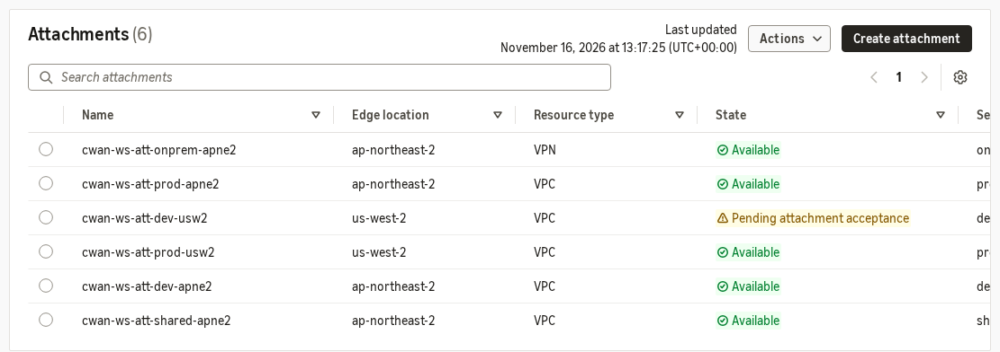
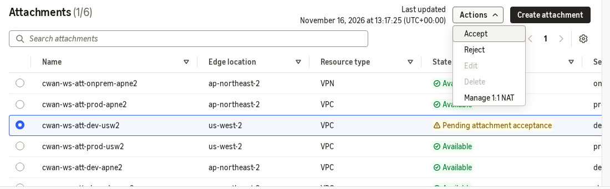
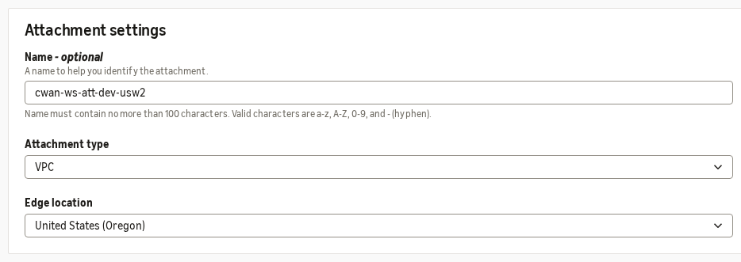
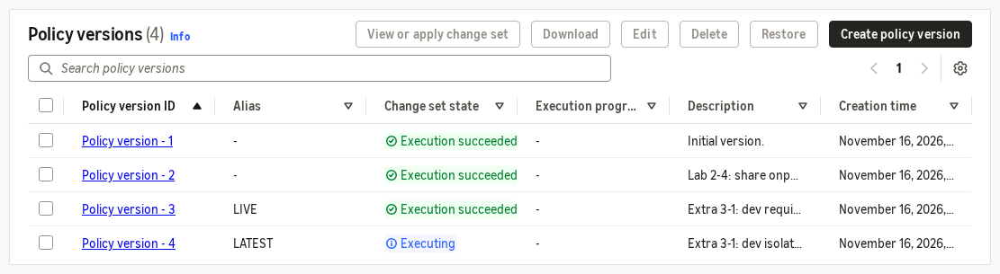
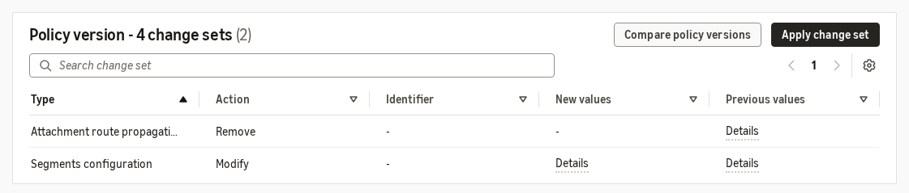

# 3-1. 연결 승인과 격리 옵션

실습에서는 세그먼트 설정 `require-attachment-acceptance`를 `false`로 두어서, 연결을 만들면 바로 세그먼트에 들어갔습니다. 운영 환경에서는 아무나 연결을 붙이지 못하게 막거나, 같은 세그먼트 안의 연결끼리도 서로 못 보게 해야 할 때가 있습니다. 이 페이지에서는 그때 쓰는 옵션 두 가지를 봅니다.

- `require-attachment-acceptance`: 연결을 만들어도 **승인해야** 세그먼트에 들어갑니다.
- `isolate-attachments`: 같은 세그먼트 안의 연결끼리도 **서로 통신하지 못합니다**.

3-1-a와 3-1-b는 읽고 이해하는 설명입니다. 3-1-c부터 3-1-g까지는 `isolate-attachments`를 **직접 해 보는 과제**입니다. 시간이 남거나 워크숍이 끝난 뒤에 혼자 해 보는 과제이며, [2-4](lab3.md)까지 마친 뒤에 하세요.

## 3-1-a. 연결 승인 요구하기 { #a-a }

`require-attachment-acceptance`를 `true`로 두면 연결이 만들어져도 바로 세그먼트에 들어가지 않고 **승인 대기** 상태로 멈춥니다. 네트워크 담당자가 승인해야 통신이 시작됩니다. 연결을 만드는 팀과 core network를 관리하는 팀이 다를 때 쓰는 안전장치입니다.

이 값은 두 곳에서 정할 수 있습니다.

| 위치 | 정책의 키 | 적용 대상 |
|---|---|---|
| 세그먼트 | `segments[]`의 `require-attachment-acceptance` | 그 세그먼트에 들어오는 모든 연결 |
| attachment policy | `attachment-policies[]`의 `action.require-acceptance` | 그 규칙에 맞는 연결 |

둘이 다르면 **attachment policy 쪽이 세그먼트 설정을 덮어씁니다**. 예를 들어 세그먼트는 `false`여도 규칙의 `require-acceptance`가 `true`이면 그 규칙에 맞는 연결은 승인이 필요합니다.

실습 정책에서 attachment policy에 넣는다면 다음 모양입니다. 이 JSON은 설명용이며, 이 페이지의 과제에서는 적용하지 않습니다.

```json
{
  "rule-number": 100,
  "conditions": [{ "type": "tag-exists", "key": "segment" }],
  "action": {
    "association-method": "tag",
    "tag-value-of-key": "segment",
    "require-acceptance": true
  }
}
```

**결과**: 세그먼트 설정과 attachment policy 설정 중 어느 쪽이 이기는지 한 문장으로 말할 수 있습니다(attachment policy).

## 3-1-b. 콘솔에서 연결 승인하기 { #a-b }

승인이 필요한 연결은 만들면 **Network Manager** 콘솔의 core network 화면에서 승인 대기 상태로 보입니다. 승인 흐름은 다음과 같습니다.

!!! info "아래 두 그림은 승인을 켠 뒤의 화면입니다"
    기본 정책은 네 세그먼트 모두 `require-attachment-acceptance` 가 `false` 라서, [2-2-d](lab1.md#lab1-d)처럼 그냥 만들면 이 **Pending attachment acceptance** 상태를 볼 수 없습니다. 아래 그림은 `dev` 세그먼트만 승인 요구로 바꾼 뒤 오레곤 dev 연결을 만들었을 때의 화면입니다. 직접 보고 싶으면 [3-1-d](#a-d)에서 연결을 **만들기 전에** `dev` 의 그 값을 `true` 로 바꿔 두세요. 바꾸는 방법은 [3-1-f](#a-f)와 같습니다. 그러면 3-1-d에서 만든 연결이 이 상태로 멈춰 서고, 아래 순서대로 승인하면 됩니다. 연결을 따로 더 만들 필요는 없습니다.

1. **Network Manager** → **Global networks** → `cwan-ws-global` → 왼쪽 메뉴 **Core network** → **Attachments** 로 갑니다.
2. **State** 가 **Pending attachment acceptance** 인 연결의 행을 선택합니다.
3. **Segment** 열에서 그 연결이 어느 세그먼트로 가려는지 확인합니다. 승인 전에도 세그먼트는 이미 정해져 있습니다. attachment policy가 태그를 보고 배정한 결과이고, 승인은 그것을 실제로 붙일지만 정합니다.
4. **Actions** → **Accept** 를 누릅니다. 같은 메뉴에 **Reject** 도 있습니다.
5. 상태가 **Creating** → **Pending network update** → **Available** 순으로 바뀝니다.

<figure markdown="span">
  { .shot }
  <figcaption>그림 1. Attachments 목록의 승인 대기 연결</figcaption>
</figure>

<figure markdown="span">
  { .shot }
  <figcaption>그림 2. Actions 메뉴의 Accept 항목</figcaption>
</figure>

!!! warning "승인하기 전에는 VPC 라우트를 넣을 수 없습니다"
    승인 대기 중인 연결의 VPC에서 core network로 가는 경로를 만들려고 하면 `InvalidCoreNetworkArn.NotFound` 로 거부됩니다. VPC가 아직 core network에 붙지 않은 것으로 취급되기 때문입니다. **승인을 먼저 하고 경로를 넣으세요.** 승인이 필요 없는 연결은 `Creating` 중에도 경로를 넣을 수 있습니다.

연결을 승인하지 않고 두면 그 연결은 세그먼트에 들어가지 못하므로 통신하지 않습니다. 승인하지 않을 연결은 **거절**하거나 삭제합니다.

**결과**: 승인 전에는 연결이 세그먼트의 경로 테이블에 경로를 내지 않고, 승인한 뒤에야 경로가 보입니다.

## 3-1-c. 과제 준비: 격리가 하는 일 { #a-c }

`isolate-attachments`를 `true`로 두면 그 세그먼트 안의 연결끼리도 통신하지 못합니다. 세그먼트는 기본적으로 같은 세그먼트 안의 연결끼리 통신하는데, 이 옵션은 그 기본값을 끕니다. 남는 경로는 두 가지뿐입니다.

- 다른 세그먼트에서 **share**로 받은 경로
- **static route**(정적 경로)

!!! info "Transit Gateway route table attachment는 예외입니다"
    **Transit Gateway route table attachment** 는 이미 있는 Transit Gateway의 라우팅 테이블을 Cloud WAN 세그먼트에 이어 주는 연결입니다. 이 워크숍에서는 쓰지 않습니다. 이 연결을 통해 들어오는 경로는 `isolate-attachments`의 영향을 받지 않아서, 옵션을 켠 세그먼트에서도 그런 경로는 그대로 남습니다.

이 과제에서는 `dev` 세그먼트에 연결을 두 개 둡니다. 서울 dev VPC(`10.20.1.0/24`)는 이미 붙어 있고, 오레곤 dev VPC(`10.21.1.0/24`)를 직접 붙입니다. 오레곤 스택이 VPC와 EC2(`10.21.1.10`)는 만들었지만 attachment는 만들지 않았습니다.

| 순서 | 하는 일 | 예상 결과 |
|---|---|---|
| 1 | 오레곤 dev VPC를 `dev`에 붙인다 | 서울 dev와 오레곤 dev가 통신한다 |
| 2 | `isolate-attachments`를 켠다 | 둘 사이 통신이 끊긴다 |
| 3 | 같은 상태에서 `shared`로 보낸다 | 그대로 통신한다 |
| 4 | 되돌린다 | 다시 통신한다 |

**결과**: `isolate-attachments`를 켠 세그먼트에 무엇이 남는지 말할 수 있습니다(share로 받은 경로와 static route).

## 3-1-d. 오레곤 dev VPC를 `dev` 세그먼트에 붙이기 { #a-d }

[2-2-d](lab1.md#lab1-d)에서 오레곤 prod VPC를 붙인 것과 같은 절차입니다. 다른 점은 대상 VPC와 태그 값입니다.

1. 리전을 **US West (Oregon)** 으로 바꾸고, **Network Manager** 콘솔에서 core network의 **Attachments** 탭으로 가 VPC attachment를 만듭니다([2-2-d](lab1.md#lab1-d)의 1~4단계).
2. **VPC ID** 드롭다운에서 `cwan-ws-dev-vpc` 를 고릅니다. **prod VPC가 아닙니다.** 고르고 나면 **Subnet IDs** 표가 가용 영역마다 한 줄씩 나오고 콘솔이 `cwan-ws-dev-cwan-az1`, `cwan-ws-dev-cwan-az2` 를 미리 채워 줍니다. 값만 확인하면 됩니다.
3. **Tags**에 두 개를 넣습니다. `Name` = `cwan-ws-att-dev-usw2`, `segment` = `dev`. 오레곤 prod를 붙였을 때의 `segment` 값은 `prod`였습니다. 태그 값이 세그먼트 이름과 대소문자까지 같아야 합니다. 이름에 리전을 넣는 이유는 [2-2-d](lab1.md#lab1-d)와 같습니다 — `dev` 세그먼트에도 서울과 오레곤 연결이 둘 다 들어갑니다.

    { .shot }

    그림 3. Create attachment 화면의 설정 패널
    { .figcap }

4. attachment가 `Available`이 되면 상세 화면에서 **Segment**가 `dev`인지 확인합니다. [2-2-d](lab1.md#lab1-d)의 오레곤 prod attachment와 똑같은 작업이고, 그쪽과 비슷하게 **4분쯤** 걸립니다.
5. 오레곤 dev 앱 서브넷의 라우트 테이블에 core network 경로를 넣습니다([2-2-e](lab1.md#lab1-e)와 같습니다). **VPC** 콘솔 → **Route tables** 에서 `cwan-ws-dev-app` 을 검색해 엽니다. `-cwan` 으로 끝나는 쪽이 아니라 **`-app`** 입니다.

    | Destination | Target |
    |---|---|
    | `10.0.0.0/8` | core network |
    | `172.16.0.0/12` | core network |

<figure markdown="span">
  { .shot }
  <figcaption>그림 4. dev 세그먼트의 서울 라우트 조회 결과</figcaption>
</figure>

**결과**: attachment가 `Available`이고 **Segment**가 `dev`입니다. 오레곤 dev 라우트 테이블의 경로 2개가 `Active`입니다.

## 3-1-e. 격리를 켜기 전에 통신 확인하기 { #a-e }

서울 dev EC2(`10.20.1.10`)와 오레곤 dev EC2(`10.21.1.10`)가 서로 닿는지 먼저 봅니다.

서울 dev EC2 `cwan-ws-dev-ec2` 에 [2-2-b](lab1.md#lab1-b)와 같은 방법(**EC2 Instance Connect Endpoint**)으로 접속해 실행합니다. 스택이 dev 서브넷에도 접속용 엔드포인트를 만들어 두었습니다.

```bash
ping -c 5 10.21.1.10
```

출력은 이렇습니다.

```text
PING 10.21.1.10 (10.21.1.10) 56(84) bytes of data.
64 bytes from 10.21.1.10: icmp_seq=1 ttl=125 time=127 ms
64 bytes from 10.21.1.10: icmp_seq=2 ttl=125 time=121 ms
64 bytes from 10.21.1.10: icmp_seq=3 ttl=125 time=121 ms
64 bytes from 10.21.1.10: icmp_seq=4 ttl=125 time=121 ms
64 bytes from 10.21.1.10: icmp_seq=5 ttl=125 time=121 ms

--- 10.21.1.10 ping statistics ---
5 packets transmitted, 5 received, 0% packet loss, time 4007ms
rtt min/avg/max/mdev = 120.849/122.037/126.761/2.361 ms
```

왕복 약 121밀리초로 [2-2-f](lab1.md#lab1-f)의 prod 쪽 리전 간 통신과 비슷합니다. 같은 백본을 쓰기 때문입니다.

**결과**: `0% packet loss` 로 응답이 옵니다. 두 연결이 같은 `dev` 세그먼트에 있고, 세그먼트의 경로는 리전을 넘어 전파되기 때문입니다. **Network Manager** 에서 `dev` 세그먼트 경로 테이블에 `10.20.1.0/24` 와 `10.21.1.0/24` 가 모두 보입니다.

## 3-1-f. `isolate-attachments` 켜고 다시 확인하기 { #a-f }

1. 정책의 새 버전을 만듭니다([2-4-a](lab3.md#lab3-a)와 같은 방법입니다).
2. `segments`의 `dev` 항목에 `isolate-attachments`를 추가합니다.

    ```json
    { "name": "dev", "description": "Development", "require-attachment-acceptance": false, "isolate-attachments": true }
    ```

3. change set을 검토하고 실행합니다([2-4-b](lab3.md#lab3-b), [2-4-c](lab3.md#lab3-c)). [2-4](lab3.md)와 같은 종류의 변경이라 change set 생성과 실행에 각각 **1분 안팎** 걸립니다.

    { .shot }

    그림 5. 정책 버전 실행 중인 Policy versions 목록
    { .figcap }

    { .shot }

    그림 6. isolate-attachments 정책의 change set
    { .figcap }

4. `Execution succeeded`가 된 뒤 서울 dev EC2에서 두 곳으로 보냅니다.

    ```bash
    ping -c 4 10.21.1.10
    ping -c 4 10.30.1.10
    ```

출력은 이렇습니다.

```text
$ ping -c 4 10.21.1.10            # 오레곤 dev, 같은 세그먼트
4 packets transmitted, 0 received, 100% packet loss, time 3109ms

$ ping -c 4 10.30.1.10            # shared, 다른 세그먼트에서 share로 받은 경로
4 packets transmitted, 4 received, 0% packet loss, time 3004ms
rtt min/avg/max/mdev = 1.050/1.801/4.012/1.276 ms
```

`isolate-attachments` 를 켠 change set은 변경이 **2건** 뿐이었습니다. `SEGMENTS_CONFIGURATION` `MODIFY` 하나와, dev attachment의 `ATTACHMENT_ROUTE_PROPAGATION` `REMOVE` 하나입니다. [2-4-b](lab3.md#lab3-b)의 share 추가가 7건이었던 것과 비교해 보세요.

두 ping을 나란히 보는 것이 이 과제의 핵심입니다. 격리는 같은 세그먼트 안의 연결 사이를 막고, 다른 세그먼트에서 share로 받은 경로는 막지 않습니다. 3-1-c에서 말한 "남는 경로" 두 가지 중 share 쪽이 이것입니다.

**결과(실패가 맞습니다)**

- 오레곤 dev(`10.21.1.10`): `100% packet loss`. 같은 `dev` 세그먼트인데도 연결끼리 통신하지 못합니다.
- `shared`(`10.30.1.10`): 응답이 옵니다. `shared`가 share로 내려 준 경로는 격리의 영향을 받지 않기 때문입니다.
- **Network Manager**의 `dev` 경로 테이블: 서울 edge에서 `10.21.1.0/24`가, 오레곤 edge에서 `10.20.1.0/24`가 사라지고 `shared` 대역(`10.30.1.0/24`)은 남습니다.

## 3-1-g. 되돌리기 { #a-g }

!!! warning "반드시 되돌리세요"
    되돌리지 않으면 [3-3](extra-c.md)에서 `dev` 경로 테이블이 다르게 보입니다.

1. 정책의 새 버전에서 `isolate-attachments`를 `false`로 바꾸거나 그 줄을 지웁니다.
2. change set을 검토하고 실행합니다. change set에는 3-1-f와 반대 방향의 변경이 보입니다.
3. `Execution succeeded`가 된 뒤 서울 dev EC2에서 다시 확인합니다.

    ```bash
    ping -c 4 10.21.1.10
    ```

출력은 이렇습니다.

```text
PING 10.21.1.10 (10.21.1.10) 56(84) bytes of data.
64 bytes from 10.21.1.10: icmp_seq=1 ttl=125 time=117 ms
64 bytes from 10.21.1.10: icmp_seq=2 ttl=125 time=115 ms
64 bytes from 10.21.1.10: icmp_seq=3 ttl=125 time=115 ms
64 bytes from 10.21.1.10: icmp_seq=4 ttl=125 time=115 ms

--- 10.21.1.10 ping statistics ---
4 packets transmitted, 4 received, 0% packet loss, time 3004ms
rtt min/avg/max/mdev = 114.517/115.148/116.981/1.057 ms
```

되돌린 뒤 통신이 돌아옵니다. 정책 버전을 하나 더 만들어 옵션을 끈 것이고, 이전 버전으로 **Restore** 하는 방법도 있습니다.

**결과**: 오레곤 dev로 다시 응답이 옵니다. 오레곤 dev attachment는 [3-4](extra-d.md)에서 지웁니다.
