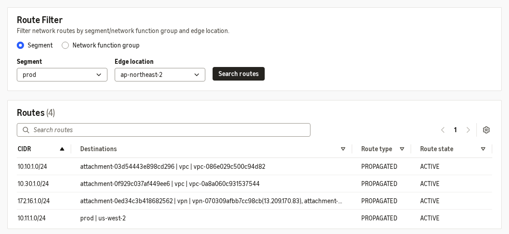
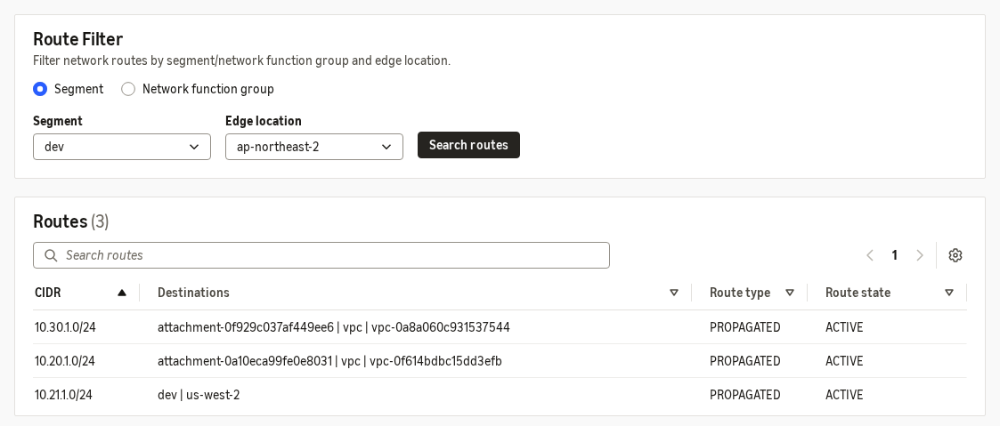

# 3-3. 경로 테이블과 지표 보기

실습에서는 ping으로 통신을 확인했습니다. 여기서는 통신이 **왜** 되는지, 또는 안 되는지를 **Network Manager**의 경로 테이블에서 읽는 법을 익힙니다. 시간이 남거나 워크숍이 끝난 뒤에 혼자 해 보는 과제입니다.

이 페이지의 그림은 [2-4](lab3.md)까지 마친 상태입니다. 거기까지 하지 않았다면 경로 테이블의 줄 수가 그림보다 적습니다. 예를 들어 온프레미스 대역(`172.16.1.0/24`)은 [2-3](lab2.md)에서 VPN을 붙여야 생기고, 그 대역이 `prod` 경로 테이블에 들어오는 것은 [2-4](lab3.md)에서 `share` 를 넣은 뒤입니다.

## 3-3-a. 세그먼트별 경로 테이블 읽기 { #c-a }

Cloud WAN은 세그먼트마다 경로 테이블을 하나씩 가집니다. 경로 테이블은 core network edge(리전)별로 볼 수 있습니다.

1. **Network Manager** → **Global networks** → `cwan-ws-global`을 엽니다.
2. core network를 열고 **Routes** 탭으로 갑니다.
3. **Route Filter** 에서 **Segment** 를 고르고(예: `prod`), **Edge location** 을 고른 뒤(예: `ap-northeast-2`) **Search routes** 를 누릅니다.

<figure markdown="span">
  { .shot }
  <figcaption>그림 3-3-1. prod 세그먼트의 서울 edge 경로 테이블</figcaption>
</figure>

경로 한 줄에서 볼 것은 다음과 같습니다.

| 볼 것 | 읽는 법 |
|---|---|
| 대역(CIDR) | 어느 네트워크로 가는 경로인지 |
| 연결(attachment) | 그 경로를 내보낸 연결. 경로가 **어느 연결에서 왔는지** 알려 줍니다 |
| edge 위치 | 경로를 가진 리전 |

같은 세그먼트라도 edge 위치에 따라 경로 테이블이 다르게 보입니다. 서울 edge의 `prod` 경로 테이블에는 서울 prod VPC(`10.10.1.0/24`)가 서울 연결에서 온 경로로, 오레곤 prod VPC(`10.11.1.0/24`)는 리전을 건너온 경로로 나타납니다.

**결과**: `prod` 세그먼트의 서울 edge 경로 테이블에서 `10.10.1.0/24`가 어느 연결에서 왔는지 가리킬 수 있습니다.

## 3-3-b. 과제: 세그먼트별로 경로 비교하기 { #c-b }

실습에서 만든 연결의 경로가 세그먼트마다 어떻게 다른지 비교합니다. 표를 채워 보세요.

| 세그먼트 | 서울 edge에서 보일 것으로 예상하는 대역 | 실제로 보인 대역 |
|---|---|---|
| `prod` | | |
| `dev` | | |
| `shared` | | |
| `onprem` | | |

확인할 질문은 다음과 같습니다.

1. `dev` 경로 테이블에 `prod` 대역(`10.10.1.0/24`)이 있나요? 없다면 이것이 [2-2-b](lab1.md#lab1-b)에서 ping이 실패한 이유입니다.
2. `prod`와 `dev` 경로 테이블 양쪽에 `shared` 대역(`10.30.1.0/24`)이 있나요? 있다면 그것이 `share`의 효과입니다.
3. [2-4](lab3.md)를 마쳤다면 `prod` 경로 테이블에 `onprem` 대역(`172.16.1.0/24`)이 있나요? 있다면 어느 연결에서 온 경로인가요?

<figure markdown="span">
  { .shot }
  <figcaption>그림 3-3-2. dev 세그먼트의 서울 edge 경로 테이블</figcaption>
</figure>

!!! info "그림의 세 번째 줄은 추가 과제 [3-1](extra-a.md)을 한 경우입니다"
    `10.21.1.0/24` 는 오레곤 dev VPC 대역입니다. 이 경로는 3-1에서 오레곤 dev 연결을 `dev` 세그먼트에 붙여야 생깁니다. 3-1을 하지 않았다면 이 표의 경로는 `10.20.1.0/24` 와 `10.30.1.0/24` **두 개**입니다. 이 과제가 보려는 것(세그먼트마다 경로가 다르다)은 두 경우 모두 같습니다.

**결과**: 세그먼트마다 경로 테이블에 들어 있는 대역이 다르다는 것을 표로 보였고, 그 차이가 ping 결과와 맞습니다.

## 3-3-c. 과제: `prod`에 오레곤 대역이 들어온 과정 { #c-c }

[2-2-d](lab1.md#lab1-d)에서 오레곤 prod VPC 연결을 만들고 `segment=prod` 태그를 붙였습니다. 이 연결의 경로가 `prod` 세그먼트에 들어온 것을 확인합니다.

1. 경로 화면에서 세그먼트를 `prod`, edge 위치를 `ap-northeast-2`로 고릅니다.
2. `10.11.1.0/24`를 찾습니다. 이 경로의 연결이 오레곤 prod VPC 연결인지 확인합니다.
3. edge 위치를 `us-west-2`로 바꿔 같은 세그먼트의 경로 테이블을 봅니다. 이번에는 `10.10.1.0/24`가 보이는지 확인합니다.

<figure markdown="span">
  { .shot }
  <figcaption>그림 3-3-3. prod 세그먼트의 오레곤 edge 경로 테이블</figcaption>
</figure>

연결 태그 한 줄로 경로가 세그먼트에 들어왔고, 서울과 오레곤 양쪽의 같은 세그먼트 경로 테이블에 서로의 대역이 나타납니다. 정책은 바꾸지 않았습니다.

**결과**: 서울 edge의 `prod` 경로 테이블에 `10.11.1.0/24`가, 오레곤 edge의 `prod` 경로 테이블에 `10.10.1.0/24`가 보입니다.

## 3-3-d. 지표와 이벤트 { #c-d }

Cloud WAN은 CloudWatch에 지표를 내보내고, 연결 상태나 정책 변경 같은 이벤트도 알려 줍니다. **Network Manager** 콘솔에도 core network 대시보드가 있습니다([공식 문서](https://docs.aws.amazon.com/network-manager/latest/cloudwan/cloudwan-visualize-networks-core.html)).

!!! warning "지표는 서울이 아니라 **오레곤**에 올라옵니다"
    공식 문서는 Cloud WAN 지표를 **US West (Oregon)** 리전에 게시한다고 적습니다. 이 워크숍은 서울에서 진행하므로, 서울 **CloudWatch** 콘솔에서 찾으면 **아무것도 나오지 않습니다.** 리전을 오레곤으로 바꾸고 보세요.

- 네임스페이스는 **`AWS/Network Manager`** 입니다.
- core network 지표에는 `BytesIn`, `BytesOut`, `PacketsIn`, `PacketsOut` 과 버려진 패킷을 세는 `PacketDropCountBlackhole`(blackhole 경로에 걸린 것), `PacketDropCountNoRoute`(맞는 경로가 없던 것)가 있습니다. **경로 설계가 잘못되면 뒤의 둘이 올라갑니다.**
- 지표는 `CoreNetwork` + `EdgeLocation` 이나 `CoreNetwork` + `Attachment` 로 걸러 봅니다. 어느 리전의, 어느 연결의 트래픽인지 나눠 볼 수 있다는 뜻입니다.
- 전체 목록은 [CloudWatch metrics in AWS Cloud WAN](https://docs.aws.amazon.com/network-manager/latest/cloudwan/cloudwan-metrics.html)에 있습니다.

**결과**: Cloud WAN 지표를 어느 리전의 어느 네임스페이스에서 찾는지 알고, `PacketDropCountNoRoute` 가 무엇을 뜻하는지 말할 수 있습니다.

## 3-3-e. 과제: 이벤트 로그 켜기 { #c-e }

core network에는 **Events** 탭이 있습니다. 연결이 붙고 빠지거나 정책이 적용될 때 무슨 일이 있었는지를 시간순으로 보여 주는 자리입니다. 그런데 **처음에는 꺼져 있습니다.**

1. [3-3-a](#c-a)에서처럼 core network를 열고, 탭 줄에서 **Events** 를 누릅니다. **Routes** 와 **Monitoring** 사이에 있습니다.
2. **Unable to show events** 안내가 보입니다. 아직 켜지 않았다는 뜻입니다.

    { .shot }

    그림 3-3-4. 켜기 전의 Events 탭
    { .figcap }

3. **Onboard to CloudWatch Logs Insights** 를 누릅니다. **확인 창은 나오지 않고 바로 켜집니다.**
4. 표가 나타나지만 **No data found.** 입니다. 고장이 아닙니다.

    { .shot }

    그림 3-3-5. 켠 직후 — 아직 이벤트가 없습니다
    { .figcap }

!!! info "켠 뒤의 이벤트만 쌓입니다"
    이미 지나간 일은 나오지 않습니다. 그래서 [2-4](lab3.md)에서 실행한 change set은 여기에 없습니다. **앞으로 일어나는 것**을 보려면 [3-4. 리소스 정리](extra-d.md)에서 연결을 지울 때 이 탭을 다시 열어 보세요. 연결이 빠지면서 경로가 걷히는 이벤트가 올라옵니다.

**버튼 하나가 무엇을 만드나요.** 셋을 만듭니다. 전부 **오레곤**에 생깁니다. Cloud WAN이 이벤트를 그 리전에 발행하기 때문입니다([3-3-d](#c-d)의 지표와 같은 이유입니다).

| 무엇 | 이름 |
|---|---|
| EventBridge 규칙 (`aws.networkmanager` 이벤트를 걸러 보냄) | `DON_NOT_DELETE_networkmanager_rule` |
| CloudWatch Logs 로그 그룹 (규칙이 보내는 곳) | `/aws/events/networkmanagerloggroup` |
| CloudWatch Logs 리소스 정책 (EventBridge에 쓰기 권한을 줌) | `DON_NOT_DELETE_networkmanager_TrustEventsToStoreLogEvents` |

!!! warning "이 과제를 했다면 정리할 것이 늘어납니다"
    세 자원은 CloudFormation 스택이 만든 것이 아니라서 **스택을 지워도 남습니다.** 로그 그룹에는 CloudWatch Logs 요금이 붙습니다(위 안내 상자가 `Additional charges apply from CloudWatch Logs.` 라고 알려 주는 것이 이것입니다). **규칙과 로그 그룹**을 [3-4-f](extra-d.md#d-f)에서 지웁니다. 리소스 정책에는 요금이 붙지 않지만, 계정 범위라서 남겨 두면 `/aws/events/` 로 시작하는 로그 그룹 전체에 EventBridge가 로그를 쓸 수 있는 권한이 그대로 남습니다.

**결과**: **Events** 탭에 안내 상자 대신 표가 보입니다. 켠 직후에는 비어 있고, 이후에 일어나는 일부터 쌓입니다.
