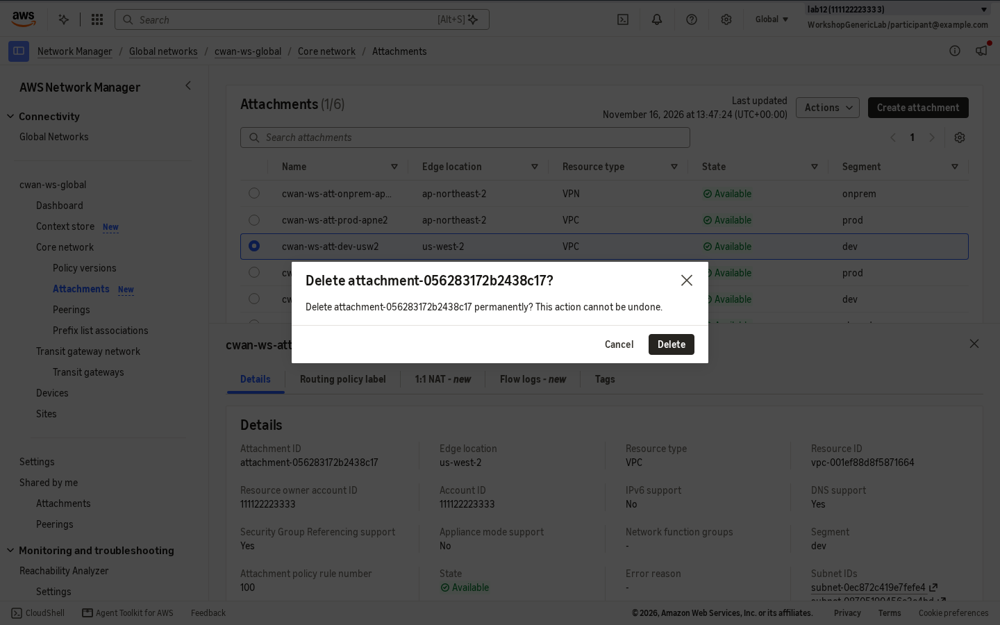
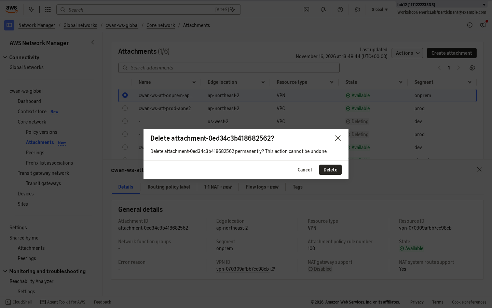

# 3-4. 리소스 정리

!!! danger "실습이 끝나면 반드시 정리합니다"
    core network edge는 리전당 시간당 요금이 붙습니다(리전당 $0.50/시간). 연결(attachment)과 VPN 연결도 시간당 요금이 붙습니다. 정리하지 않으면 요금이 계속 늘어납니다.

실습이 끝나면 만든 리소스를 지웁니다. 아래 **순서대로** 진행합니다. **순서가 중요합니다.** 참가자가 직접 만든 것을 먼저 지우고, 그다음에 스택을 지웁니다. core network는 연결이 하나라도 남아 있으면 지워지지 않기 때문입니다.

| 순서 | 지울 것 | 누가 만들었나 | 소요 시간 |
|---|---|---|---|
| 1 | 오레곤 VPC attachment (prod, 그리고 [3-1](extra-a.md)을 했다면 dev도) | 참가자([2-2-d](lab1.md#lab1-d), [3-1-d](extra-a.md#a-d)) | **몇 분 안쪽** |
| 2 | Site-to-Site VPN attachment | 참가자([2-3-b](lab2.md#lab2-b)) | **1분 안쪽** |
| 3 | Site-to-Site VPN 연결 | 참가자([2-3-a](lab2.md#lab2-a)) | **몇 분 안쪽** |
| 4 | 오레곤 스택 `cloudwan-workshop-oregon` | CloudFormation | **2분 안쪽** |
| 5 | 서울 스택 `cloudwan-workshop-seoul` | CloudFormation | **15분쯤** |

정리 전체는 **20분 남짓** 걸리고, 그중 **대부분이 마지막 서울 스택 하나**입니다. 앞의 네 단계는 다 합쳐도 몇 분이면 끝납니다.

## 3-4-a. 오레곤 VPC attachment 지우기 { #d-a }

1. **Network Manager** → **Global networks** → `cwan-ws-global` → **Core network** → **Attachments**로 갑니다.
2. 오레곤(`us-west-2`)의 prod VPC 연결 행의 **선택 버튼**을 누르고 **Actions** → **Delete** 를 누릅니다. `Delete attachment-…?` 창이 뜨고 `Delete attachment-… permanently? This action cannot be undone.` 이라고 묻습니다. **Delete** 를 눌러 확정합니다.
3. 추가 과제 [3-1](extra-a.md)을 했다면 오레곤의 **dev VPC 연결도** 같은 방법으로 삭제합니다. 이 연결은 `segment=dev` 태그가 붙어 있습니다.

    !!! warning "오레곤 연결을 하나라도 남기면 뒤 단계가 막힙니다"
        오레곤 VPC 연결이 남아 있으면 오레곤 스택의 VPC가 지워지지 않고, 서울 스택의 core network도 지워지지 않습니다.

<figure markdown="span">
  { .shot }
  <figcaption>그림 3-4-1. attachment 삭제 확인 창</figcaption>
</figure>

**결과**: 연결이 목록에서 사라지거나 삭제된 상태가 됩니다. 오레곤 VPC 연결이 **하나도** 보이지 않을 때까지 기다린 뒤 다음으로 넘어갑니다.

## 3-4-b. Site-to-Site VPN attachment 지우기 { #d-b }

같은 **Attachments** 화면에서 온프레미스 쪽 Site-to-Site VPN 연결([2-3-b](lab2.md#lab2-b)에서 만든 `cwan-ws-att-onprem-apne2`, `segment=onprem`)을 고르고 **Actions** → **Delete** 로 지웁니다.

<figure markdown="span">
  { .shot }
  <figcaption>그림 3-4-2. VPN attachment 삭제 확인 창</figcaption>
</figure>

**결과**: VPN attachment가 목록에서 사라지거나 삭제된 상태가 됩니다. 이 단계가 끝나면 core network에는 서울 VPC 연결 3개만 남습니다(스택이 만든 연결입니다).

## 3-4-c. Site-to-Site VPN 연결 지우기 { #d-c }

**VPN attachment가 목록에서 완전히 사라진 뒤에야** VPN 연결을 지울 수 있습니다. attachment가 아직 지워지는 중일 때 VPN 연결을 지우려 하면 이렇게 거부됩니다.

```text
UnsupportedOperation: Unable to delete a vpn that's associated to a Core Network
```

attachment가 `Deleting` 인 동안 VPN 연결의 상태는 `Modifying` 으로 보입니다. 그 상태가 끝날 때까지 기다리세요.

1. **VPC** 콘솔(서울) → **Site-to-Site VPN connections**로 갑니다.
2. [2-3-a](lab2.md#lab2-a)에서 만든 VPN 연결을 고르고 **Actions** → **Delete VPN connection**을 누릅니다.
3. 확인 창에서 삭제를 확정합니다.

**결과**: VPN 연결의 상태가 **Deleted**가 됩니다. customer gateway는 스택이 만든 것이므로 그대로 둡니다. 서울 스택을 지울 때 함께 지워집니다.

## 3-4-d. 오레곤 스택 지우기 { #d-d }

1. 리전을 오레곤(`us-west-2`)으로 바꿉니다.
2. **CloudFormation** → `cloudwan-workshop-oregon` 을 열고 **Delete stack** 을 누릅니다.
3. **Delete stack?** 창이 열립니다. **스택 이름을 그대로 입력해야** 삭제 버튼이 눌립니다. 입력 칸에 `cloudwan-workshop-oregon` 을 적고 **Delete stack** 을 누릅니다.

    !!! warning "이름을 입력하기 전에는 버튼이 회색입니다"
        [3-4-a](#d-a)·[3-4-b](#d-b)의 attachment 삭제 창은 **Delete** 만 누르면 됐습니다. 두 단계 만에 요령이 바뀌는 자리라 적어 둡니다. 창에는 `Type "cloudwan-workshop-oregon" to confirm deletion of the stack.` 이라고 적혀 있고, 그 칸이 비어 있는 동안 버튼은 회색입니다.

    !!! info "**Express mode** 는 켜지 마세요"
        같은 창에 **Express mode - new** 라는 선택지가 있고 `Delete this stack faster.` 라고 적혀 있습니다. 리소스가 안정될 때까지 기다리지 않고 정리한다는 뜻입니다. **기본값(꺼짐) 그대로 두세요.** 이 단계에서 중요한 것은 빨리 끝나는 것이 아니라 **하나도 남지 않는 것**입니다. 남은 core network edge는 지워질 때까지 시간당 요금이 계속 붙습니다.

**결과**: 스택이 목록에서 사라집니다(`DELETE_COMPLETE`). 오레곤의 prod·dev VPC와 EC2 두 대가 함께 지워집니다. **2분 안쪽**입니다.

## 3-4-e. 서울 스택 지우기 { #d-e }

1. 리전을 서울(`ap-northeast-2`)로 바꿉니다.
2. **CloudFormation** → `cloudwan-workshop-seoul` 을 열고 **Delete stack** 을 누릅니다.
3. 창의 입력 칸에 `cloudwan-workshop-seoul` 을 적고 **Delete stack** 을 누릅니다. [3-4-d](#d-d)와 같은 창이며, 이름을 입력하기 전에는 버튼이 눌리지 않습니다.

!!! warning "이 삭제는 15분쯤 걸립니다"
    core network를 지우는 데 시간이 걸리기 때문이고, [2-1-b](lab0.md#lab0-b)에서 core network를 만들 때 걸린 15분과 거의 같습니다. 화면을 닫아도 삭제는 계속됩니다.

**결과**: 스택이 목록에서 사라집니다(`DELETE_COMPLETE`). core network, global network, 서울의 VPC와 EC2가 함께 지워집니다.

### 스택 삭제가 실패할 때 { #d-fail }

가장 흔한 원인은 **연결이 남아 있어 core network가 지워지지 않는 것**입니다. 스택이 `DELETE_FAILED`가 되면 다음 순서로 확인합니다.

1. **Events** 탭에서 실패한 리소스와 이유를 봅니다.
2. core network에 연결이 남아 있는지 **Network Manager** → **Core network** → **Attachments**에서 봅니다. 참가자가 만든 오레곤 VPC 연결이나 VPN 연결이 남아 있으면 3-4-a, 3-4-b로 돌아가 지웁니다.
3. 연결이 모두 사라졌으면 스택에서 **Delete stack** 을 다시 누릅니다. 이때도 창의 입력 칸에 스택 이름을 적어야 버튼이 눌립니다([3-4-d](#d-d)).

!!! warning "오레곤 스택을 먼저 지우지 않았다면"
    오레곤 VPC 연결을 먼저 지우지 않고 오레곤 스택을 지우면 VPC가 지워지지 않을 수 있습니다. 연결을 지운 뒤 스택 삭제를 다시 시도하세요.

그래도 해결되지 않으면 [4-3 문제 해결](troubleshooting.md)을 보세요.

## 3-4-f. 마무리 { #d-f }

아래를 모두 확인하면 정리가 끝납니다.

- [ ] 오레곤 VPC attachment가 없습니다(prod, 그리고 [3-1](extra-a.md)을 했다면 dev도)
- [ ] Site-to-Site VPN attachment가 없습니다
- [ ] Site-to-Site VPN 연결이 **Deleted**입니다(서울)
- [ ] 스택 `cloudwan-workshop-oregon`이 `DELETE_COMPLETE`입니다(오레곤)
- [ ] 스택 `cloudwan-workshop-seoul`이 `DELETE_COMPLETE`입니다(서울)
- [ ] **Network Manager**에 `cwan-ws-global`(global network)과 core network가 없습니다
- [ ] 서울과 오레곤의 EC2 콘솔에 실습 EC2가 없습니다

!!! warning "[3-3-e](extra-c.md#c-e)에서 이벤트 로그를 켰다면 두 가지가 더 남아 있습니다"
    그 버튼이 만든 것은 **스택이 만든 것이 아니라서 스택을 지워도 남습니다.** 둘 다 **오레곤**에 있습니다. 로그 그룹은 CloudWatch Logs 요금이 붙으니 지웁니다.

    - [ ] **EventBridge** 의 규칙 `DON_NOT_DELETE_networkmanager_rule` 을 지웁니다
    - [ ] **CloudWatch** → **Logs** → **Log groups** 의 `/aws/events/networkmanagerloggroup` 을 지웁니다

    이름에 `DON_NOT_DELETE` 가 들어 있지만 **지우는 것이 맞습니다.** 그 이름은 로그가 켜져 있는 동안 실수로 지우지 말라는 뜻으로 콘솔이 붙인 것입니다(`DO_NOT`이 아니라 `DON_NOT`인 것도 AWS 쪽 오타 그대로입니다).

    버튼이 만든 것이 하나 더 있습니다 — CloudWatch Logs의 리소스 정책 `DON_NOT_DELETE_networkmanager_TrustEventsToStoreLogEvents` 입니다. **요금은 붙지 않습니다.** 다만 이 정책은 계정 범위여서, 남겨 두면 `/aws/events/` 로 시작하는 로그 그룹 전체에 EventBridge가 로그 스트림을 만들고 쓸 수 있는 권한이 유지됩니다. 그것까지 정리하려면 CloudWatch Logs의 리소스 정책에서 지웁니다.

**결과**: 위 체크 목록이 모두 확인되었습니다.
