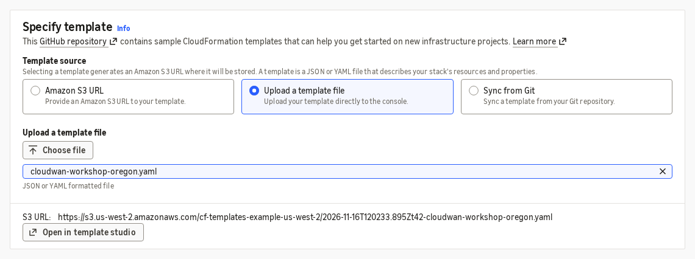
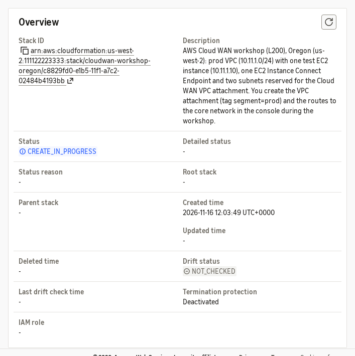
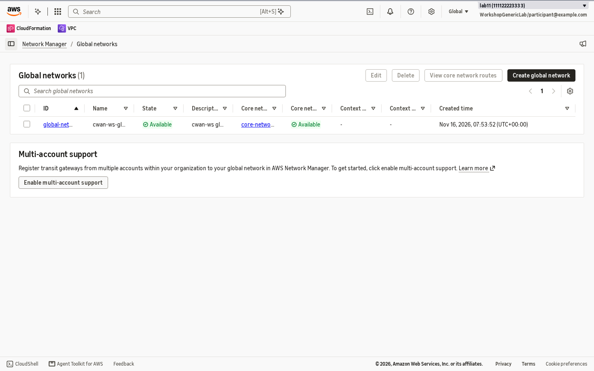
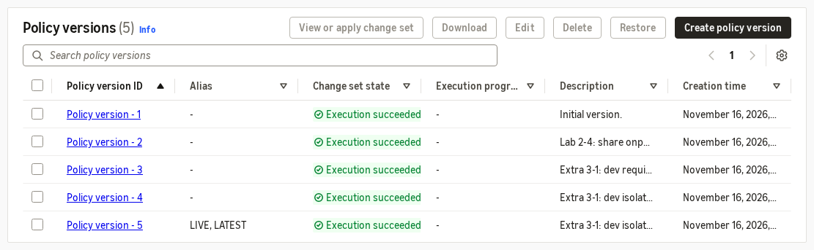

# 2-1. 시작하기

이 페이지는 **이론 강의를 듣기 전에** 합니다. Cloud WAN의 core network는 처음 만들 때 최대 30분이 걸립니다([공식 문서](https://docs.aws.amazon.com/network-manager/latest/cloudwan/cloudwan-getting-started.html)). 그동안에는 attachment(연결)와 policy version(정책 버전)을 만들 수 없습니다. 그래서 스택 2개를 먼저 배포해 두고, 이론 강의를 듣는 동안 core network가 백그라운드로 완성되게 합니다. 배포가 끝나기를 기다리지 않습니다.

지금부터 배포하는 스택 2개가 무엇을 만드는지 먼저 그림으로 봅니다. 분홍색 **CloudFormation** 표시가 붙은 것이 스택이 만드는 것이고, 주황색 **콘솔에서 직접** 표시가 붙은 넷이 여러분이 [2-2](lab1.md)부터 직접 만들 것입니다.

<figure markdown="span">
  ![AWS Cloud WAN L200 워크숍 전체 구성도. 그림은 왼쪽 아래의 온프레미스에서 시작해 오른쪽 위의 AWS로 이어진다. 생성 주체는 색이 다른 표시로 구분한다. 분홍색 CloudFormation 표시는 스택이 만드는 것, 주황색 콘솔에서 직접 표시는 참가자가 콘솔에서 만드는 것, 먹색 segment= 표시는 그 연결이 배정되는 세그먼트를 뜻한다. 왼쪽 아래, AWS Cloud 테두리 바깥에 회색 온프레미스 박스가 있다. 제목은 온프레미스이고 그 옆에 분홍색 CloudFormation 표시가 붙어 있어 이 박스 전체를 CloudFormation 스택이 만든다는 것을 나타낸다. 제목 아래에는 172.16.1.0/24와 실제로는 서울 리전의 모사 VPC라고 적혀 있다. 박스 안에는 온프레미스 VM 172.16.1.10과, strongSwan·FRR을 돌리며 Elastic IP와 ASN 65000을 가진 VPN 라우터 EC2가 선으로 이어져 있다. 라우터에서 오른쪽으로 인터넷 아이콘(아무도 만들지 않으므로 표시 없음)을 지나 Site-to-Site VPN 아이콘으로 가는데, 그 아래에는 IPsec 터널 2개와 BGP, 그리고 주황색 콘솔에서 직접 표시가 붙어 있다. 이 VPN 연결은 참가자가 콘솔에서 만든다. 거기서 선이 위로 올라가 AWS Cloud 안으로 들어간다. AWS Cloud 안에는 왼쪽에 서울 리전(아시아 태평양(서울) ap-northeast-2), 오른쪽에 오레곤 리전(미국 서부(오레곤) us-west-2)이 있다. 서울 리전 위쪽에는 VPC 세 개가 나란히 있다. prod VPC 10.10.1.0/24에 EC2 10.10.1.10, dev VPC 10.20.1.0/24에 EC2 10.20.1.10, shared VPC 10.30.1.0/24에 EC2 10.30.1.10이 각각 서브넷 안에 있다. 오레곤 리전 위쪽에는 VPC 두 개가 있다. prod VPC 10.11.1.0/24에 EC2 10.11.1.10, dev VPC 10.21.1.0/24에 EC2 10.21.1.10이다. 두 리전을 가로질러 보라색 점선 띠가 지나가는데 이것이 AWS Cloud WAN의 core network이고, 그 안에는 위에서부터 prod, dev, shared 세그먼트 행이 있고 그 아래 core network edge 행, 맨 아래 onprem 세그먼트 행이 있다. edge 행에는 서울 edge(ASN 64512)와 오레곤 edge(ASN 64513)가 있고 둘은 AWS 백본이라고 적힌 선으로 이어져 있다. 서울의 세 VPC에서 각각 선이 아래로 내려와 서울 edge에, 오레곤의 두 VPC에서 각각 선이 내려와 오레곤 edge에 연결된다. 각 선이 자기 세그먼트 행과 만나는 자리에는 회색 점이 찍혀 그 연결이 어느 세그먼트에 배정되는지를 보여 준다. dev 세그먼트 행에는 점이 둘 있는데, 서울 dev VPC와 오레곤 dev VPC가 같은 세그먼트에 들어가 리전을 넘어 통신한다는 뜻이다. 선마다 옆에 표시가 붙어 있다. 서울 prod는 segment=prod와 분홍 CloudFormation, 서울 dev는 segment=dev와 분홍 CloudFormation, 서울 shared는 segment=shared와 분홍 CloudFormation으로 세 연결 모두 CloudFormation이 만든다. 오레곤 prod는 segment=prod와 주황 콘솔에서 직접으로 참가자가 본편 실습에서 만들고, 오레곤 dev는 segment=dev, 주황 콘솔에서 직접, 그리고 추가 과제 3-1이라는 글귀가 붙어 참가자가 추가 과제에서 만든다. 온프레미스에서 올라온 선은 onprem 세그먼트 행에서 점을 찍고 서울 edge로 들어가며, 그 옆에 먹색 segment=onprem과 주황 콘솔에서 직접 표시가 붙어 있다. 이 VPN attachment도 참가자가 만든다. 정리하면 참가자가 콘솔에서 직접 만드는 것은 주황 표시가 붙은 네 가지다. VPN 연결, VPN attachment, 오레곤 prod 연결, 오레곤 dev 연결(추가 과제)이다. 나머지(온프레미스 환경 전체, 다섯 개 VPC와 EC2, 서울의 연결 세 개, core network와 세그먼트)는 CloudFormation 스택이 만든다. 그림 아래 범례는 네 가지를 설명한다. 연결선과 세그먼트 행이 만나는 점은 그 연결이 배정된 세그먼트이며 배정은 연결에 붙인 segment 태그로 결정된다는 것, AWS 백본은 두 core network edge 사이의 자동 연결이라 참가자가 만들 것이 없다는 것, 추가 과제 3-1은 본편 실습이 아니라 추가 과제에서 만드는 연결이라는 것, 그리고 CloudFormation은 스택이 만들고 콘솔에서 직접은 참가자가 만든다는 것이다](images/architecture.png)
  <figcaption>그림 2-1-1. 워크숍 전체 구성 — 분홍색은 스택이, 주황색은 참가자가 만듭니다</figcaption>
</figure>

## 2-1-a. 콘솔에 로그인하기 { #lab0-a }

1. 강사가 알려 준 계정 정보로 AWS 콘솔에 로그인합니다.
2. 콘솔 오른쪽 위의 리전 선택 메뉴에서 **Asia Pacific (Seoul)** 을 고릅니다.
3. 화면 언어를 영어로 맞춥니다. 이 워크숍의 버튼 이름은 모두 영어 화면 기준입니다. 리전 선택 메뉴 왼쪽의 **톱니바퀴 아이콘**을 누르면 **Current user settings** 창이 열립니다. **Language** 에서 **English (US)** 를 고릅니다.

    { .shot }

    그림 2-1-2. 콘솔 오른쪽 위의 Current user settings 창
    { .figcap }

    !!! tip "기본값이 **Browser default** 라서 이 단계가 필요합니다"
        브라우저가 한국어면 콘솔도 한국어로 나옵니다. 콘솔 **아래쪽 푸터에는 언어를 바꾸는 항목이 없습니다**. 더 많은 설정은 같은 창의 **See all user settings** 에 있습니다.

**결과**: 콘솔 오른쪽 위에 **Asia Pacific (Seoul)** 이 보이고, 메뉴가 영어로 나옵니다.

## 2-1-b. 서울 스택 배포하기 { #lab0-b }

서울 스택은 워크숍의 중심인 core network와 서울 쪽 리소스를 만듭니다.

- global network `cwan-ws-global`과 core network (초기 policy 포함, 세그먼트 4개, edge 2개: 서울·오레곤)
- prod VPC(`10.10.1.0/24`), dev VPC(`10.20.1.0/24`), shared VPC(`10.30.1.0/24`)와 각 VPC의 EC2 1대
- 온프레미스를 흉내 내는 VPC(`172.16.1.0/24`): 퍼블릭 서브넷의 VPN 라우터 EC2와 프라이빗 서브넷의 VM EC2
- 서울 prod·dev·shared VPC를 core network에 붙이는 VPC attachment 3개(`segment` 태그 포함)
- customer gateway(온프레미스 라우터의 Elastic IP, ASN `65000`)
- EC2 Instance Connect Endpoint 3개: prod VPC, dev VPC, 온프레미스를 흉내 내는 VPC의 EC2에 브라우저로 접속할 때 씁니다. shared VPC의 EC2는 ping을 받는 쪽이라 접속하지 않습니다

1. 리전이 **Asia Pacific (Seoul)** 인지 다시 확인합니다.
2. 템플릿 파일을 내려받습니다: [cloudwan-workshop-seoul.yaml](assets/cloudwan-workshop-seoul.yaml){ download }
3. **CloudFormation** 콘솔 → **Create stack** → **With new resources (standard)** 를 누릅니다.
4. **Upload a template file** → **Choose file**로 내려받은 파일을 고르고 **Next**를 누릅니다.

    { .shot }

    그림 2-1-3. Create stack의 Specify template 패널
    { .figcap }

5. **Stack name**에 `cloudwan-workshop-seoul`을 넣습니다. **Parameters**는 그대로 두고 **Next**를 누릅니다.

    { .shot }

    그림 2-1-4. Create stack의 Specify stack details 화면
    { .figcap }

6. **Configure stack options** 화면에서도 **Next**를 누릅니다. 마지막 **Review and create** 화면 맨 아래 **Capabilities** 에 다음이 나옵니다.

    > The following resource(s) require capabilities: [AWS::IAM::Role]

    **I acknowledge that AWS CloudFormation might create IAM resources.** 확인란을 선택합니다. 이 스택이 EC2에 붙일 IAM 역할(role)과 인스턴스 프로파일을 만들기 때문입니다. 선택하지 않으면 **Please acknowledge all checkboxes before proceeding.** 이 뜨고 넘어가지 않습니다.

    ![Review and create 화면 맨 아래 Capabilities 패널. The following resource(s) require capabilities: [AWS::IAM::Role]이라는 안내와 함께 I acknowledge that AWS CloudFormation might create IAM resources. 확인란이 하나 있고 파란색으로 체크되어 있다. 이 확인란이 Capabilities 패널의 유일한 선택 항목이다](images/console/lab0-cfn-03-ack.png){ .shot }

    그림 2-1-5. Review and create 화면의 Capabilities 패널
    { .figcap }

7. **Submit** 을 누릅니다.

**결과**: 스택 상태가 **CREATE_IN_PROGRESS**입니다. **CREATE_COMPLETE** 까지 **20분 안팎** 걸립니다. 다만 다음 실습으로 넘어가는 기준은 스택 완료가 아니라 core network 준비입니다. core network 는 **15분쯤** 지나면 쓸 수 있고, 스택은 EC2 부트스트랩과 VPC attachment 생성 때문에 그 뒤로도 한동안 **CREATE_IN_PROGRESS** 입니다. 보는 법은 [2-1-d](#lab0-d)에 있습니다.

<figure markdown="span">
  { .shot }
  <figcaption>그림 2-1-6. 서울 스택의 Overview 패널</figcaption>
</figure>

## 2-1-c. 오레곤 스택 배포하기 { #lab0-c }

오레곤 스택은 오레곤 쪽 VPC 2개와 각 VPC의 EC2 1대를 만듭니다. 본편 실습에서 쓰는 것은 prod VPC(`10.11.1.0/24`)이고, dev VPC(`10.21.1.0/24`)는 추가 과제 [3-1](extra-a.md)에서 씁니다. EC2 Instance Connect Endpoint는 prod VPC에만 있습니다. 오레곤 VPC를 core network에 붙이는 일은 이 스택이 하지 않습니다. 실습 2-2에서 직접 합니다.

!!! warning "리전을 바꾸는 것을 잊지 마세요"
    오레곤 스택은 **US West (Oregon)** 에서만 배포됩니다. 콘솔 오른쪽 위의 리전 선택 메뉴에서 먼저 **US West (Oregon)** 으로 바꾼 뒤 시작합니다. 서울에 그대로 두면 템플릿이 거부합니다. 서울 스택이 아직 배포 중이어도 상관없으니 바로 이어서 합니다.

1. 리전을 **US West (Oregon)** 으로 바꿉니다.
2. 템플릿 파일을 내려받습니다: [cloudwan-workshop-oregon.yaml](assets/cloudwan-workshop-oregon.yaml){ download }
3. **CloudFormation** 콘솔 → **Create stack** → **With new resources (standard)** → **Upload a template file** → **Choose file**로 파일을 고르고 **Next**를 누릅니다.

    { .shot }

    그림 2-1-7. 오레곤 스택의 Specify template 패널
    { .figcap }

4. **Stack name**에 `cloudwan-workshop-oregon`을 넣습니다. **Parameters**는 그대로 두고 **Next**를 누릅니다.
5. **Next** 를 두 번 더 눌러 **Review and create** 까지 간 다음 **Submit** 을 누릅니다. 이 스택은 IAM 리소스를 만들지 않으므로 서울 스택에서 봤던 **Capabilities** 확인란은 **나오지 않습니다**. 바로 넘어갑니다.

**결과**: 오레곤 리전에서 스택 상태가 **CREATE_IN_PROGRESS**입니다.

<figure markdown="span">
  { .shot }
  <figcaption>그림 2-1-8. 오레곤 스택의 Overview 패널</figcaption>
</figure>

## 2-1-d. core network가 준비됐는지 보는 법 { #lab0-d }

준비가 끝났는지는 스택 상태가 아니라 **Policy versions** 화면에서 봅니다. core network는 스택보다 먼저 준비되므로, 스택이 **CREATE_COMPLETE**가 되기를 기다릴 필요가 없습니다. 지금은 보는 법만 익히고, 실제 확인은 이론 강의가 끝난 뒤 실습 2-2 시작 전에 합니다.

1. **Network Manager** 콘솔 → **Global networks**를 엽니다. Cloud WAN은 리전에 묶이지 않아서 오른쪽 위 리전 선택에 **Global** 이 뜹니다.

    !!! tip "Network Manager 화면은 어디에 있나요"
        서비스 목록에 **Network Manager** 라는 이름으로 따로 있지 않습니다. 둘 중 편한 쪽으로 가세요.

        - 콘솔 맨 위 **검색창**에 `Cloud WAN` 을 칩니다. **Cloud WAN**(**VPC feature** 로 분류됩니다)이 나오면 그것을 누릅니다.
        - 또는 **VPC** 콘솔을 열고 왼쪽 메뉴에서 **Get started with Network Manager** 를 누릅니다. Cloud WAN은 VPC 콘솔 안의 기능으로 들어가 있습니다.

    { .shot }

    그림 2-1-9. Network Manager의 Global networks 목록
    { .figcap }

2. `cwan-ws-global`을 엽니다. **global network** 는 Cloud WAN 리소스를 담는 바깥 상자입니다. 그 안에 core network가 들어 있습니다. 스택을 배포한 직후에는 core network가 아직 목록에 없거나 생성 중으로 보일 수 있습니다.
3. 왼쪽 메뉴에서 **Policy versions** 를 엽니다.

    { .shot }

    그림 2-1-10. core network의 Policy versions 화면
    { .figcap }

4. 정책이 **LIVE** 이고 **Change set state** 가 **Execution succeeded** 이면 준비가 끝난 것입니다. 위 그림의 **Alias** 와 **Change set state** 열에서 봅니다.

아직 준비되지 않았으면 여기서 기다리지 않습니다. 이론 강의를 들으러 갑니다.

**결과**: **Policy versions** 가 어디에 있는지 알고, 어떤 값이 보이면 준비 완료인지 말할 수 있습니다.

## 2-1-e. 정리 { #lab0-e }

| 확인한 것 | 결과 |
|---|---|
| 콘솔 리전과 언어 | **Asia Pacific (Seoul)**, 영어 |
| 서울 스택 `cloudwan-workshop-seoul` | **CREATE_IN_PROGRESS** 또는 **CREATE_COMPLETE** |
| 오레곤 스택 `cloudwan-workshop-oregon` | **CREATE_IN_PROGRESS** 또는 **CREATE_COMPLETE** |
| core network 준비 기준 | **Policy versions** 에서 **LIVE**, **Change set state**가 **Execution succeeded** |

이제 이론 강의를 듣습니다. 강의가 끝나면 [2-2](lab1.md)로 넘어갑니다.
