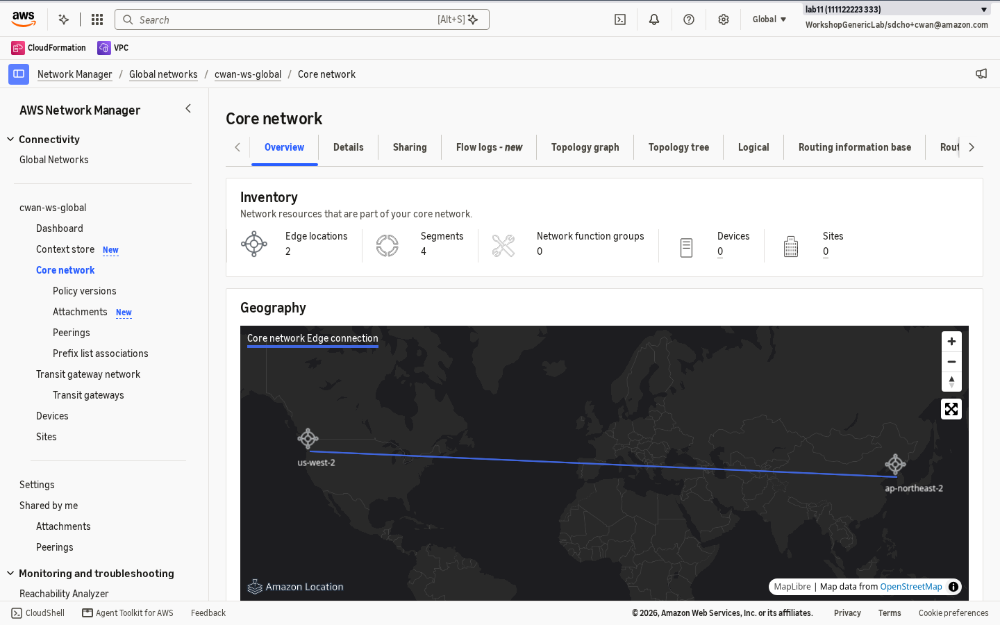
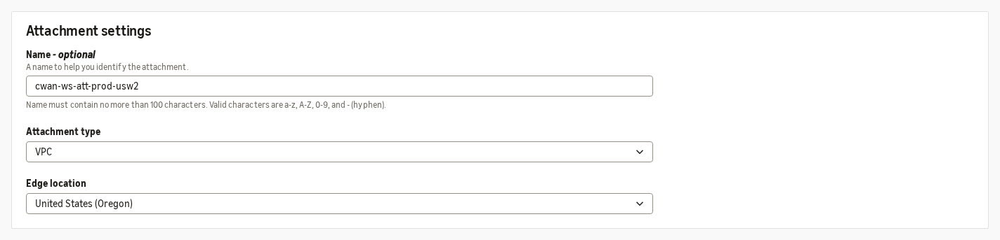
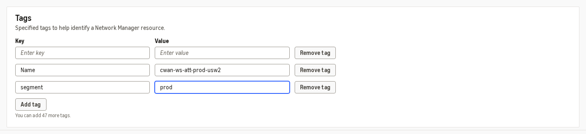
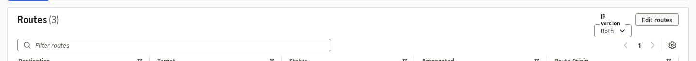

# 2-2. 세그먼트와 글로벌 연결 (22분)

이 실습에서는 core network 안의 세그먼트가 서로를 어떻게 막고 여는지 확인하고, 오레곤 리전의 VPC를 core network에 연결해 서울과 통신합니다.

아래 그림 1의 번호 순서로 진행합니다. 처음 보는 용어는 [1-3. 용어 풀이](glossary.md)를 보세요.

그림 1의 오레곤 dev VPC에는 연결선이 없습니다. 이 실습에서는 붙이지 않고, 추가 과제 [3-1](extra-a.md)에서 붙입니다.

<figure markdown="span">
  ![AWS Cloud 안에 왼쪽은 아시아 태평양(서울) 리전, 가운데는 Cloud WAN core network(서울 edge AS 64512, 오레곤 edge AS 64513), 오른쪽은 미국 서부(오레곤) 리전이 있는 구성도. 서울 리전에는 위에서부터 dev VPC 10.20.1.0/24, prod VPC 10.10.1.0/24, shared VPC 10.30.1.0/24가 있고, 각 VPC 안에는 ICMP를 허용한 보안 그룹과 테스트용 EC2(10.20.1.10, 10.10.1.10, 10.30.1.10)가 들어 있다. 오레곤 리전에는 dev VPC 10.21.1.0/24(EC2 10.21.1.10)와 prod VPC 10.11.1.0/24(EC2 10.11.1.10)가 있다. core network 안은 dev, prod, shared 세 세그먼트가 가로 레인으로 나뉘어 있고, 각 레인에는 그 세그먼트에 배정된 VPC attachment가 놓여 있다. 맨 윗줄에서 서울 dev VPC는 dev 세그먼트의 VPC attachment로 연결되어 있지만, 같은 줄 오른쪽의 오레곤 dev VPC에는 연결선이 없고 attachment 없음, 추가 과제 3-1이라고 적혀 있어 실습 2-2 시점에는 아직 core network에 붙어 있지 않음을 보여 준다. 번호 1은 prod 세그먼트에서 dev 세그먼트로 향하는 빨간 점선 화살표에 차단과 실패, 100% packet loss가 붙어, 보안 그룹이 열려 있어도 세그먼트가 기본 격리이므로 서울 prod EC2에서 서울 dev EC2로 가는 ping이 실패함을 보여 준다. 2는 prod 세그먼트에서 shared 세그먼트로 내려가는 녹색 화살표에 성공, 응답 있음이 붙어, 정책의 share 덕분에 서울 prod에서 shared로 가는 통신이 성공함을 보여 준다. 3은 오레곤 prod VPC를 core network에 붙이는 VPC attachment 위의 segment=prod 태그 칩으로, 참가자가 attachment를 만들고 태그를 붙이는 단계다. 4는 그 attachment가 prod 세그먼트 레인 안에 들어가 있는 자리에 붙어, attachment policy 규칙 100의 tag-exists, segment 조건이 태그 값을 보고 attachment를 prod 세그먼트에 자동 배정했음을 나타낸다. 참가자는 세그먼트를 직접 고르지 않는다. 바로 위의 오레곤 dev VPC는 아직 attachment가 없어 어떤 세그먼트에도 들어가 있지 않으므로, 붙이고 태그를 단 것만 세그먼트에 배정된다는 점이 나란히 드러난다. 5는 prod 세그먼트 레인 안에서 서울 prod attachment에서 오레곤 prod attachment로 가는 녹색 화살표에 성공, 응답 있음이 붙어, 서울 edge와 오레곤 edge가 이미 연결되어 있고 prod 세그먼트 경로가 리전 간에 자동 전파되므로 서울 prod EC2에서 오레곤 prod EC2로 가는 ping이 성공함을 보여 준다. 그림 아래 범례에 1부터 5까지의 설명이 번호 순서로 적혀 있다](images/diagrams/lab1-global.png)
  <figcaption>그림 1. 실습 2-2에서 하는 일</figcaption>
</figure>

| 번호 | 단계 | 내용 |
|---|---|---|
| ① | prod → dev 실패 | 서울 prod EC2에서 dev EC2로 ping을 보냅니다. 세그먼트가 달라 실패하는 것이 맞습니다. |
| ② | prod → shared 성공 | 서울 prod EC2에서 shared EC2로 ping을 보냅니다. 정책의 `share` 덕분에 성공합니다. |
| ③ | 오레곤 attachment 생성과 태그 | 오레곤 VPC를 core network에 연결하고 태그 `segment` = `prod` 를 붙입니다. |
| ④ | attachment policy가 세그먼트에 배정 | 참가자가 세그먼트를 고르지 않습니다. 정책이 태그를 읽고 `prod` 세그먼트에 배정합니다. |
| ⑤ | 서울 prod → 오레곤 prod 성공 | 서울 prod EC2에서 오레곤 prod EC2로 ping을 보냅니다. 두 edge 사이 연결은 이미 있습니다. |

시작하기 전에 확인합니다.

- 실습 2-1에서 서울 스택과 오레곤 스택이 모두 **CREATE_COMPLETE**인가요?
- core network 왼쪽 메뉴의 **Policy versions** 에서 정책이 `LIVE`이고, Change set state가 `Execution succeeded`인가요? 아직이면 2-2-a만 먼저 하고 기다립니다.

## 2-2-a. core network 둘러보기 { #lab1-a }

먼저 스택이 만든 core network를 눈으로 봅니다. 여기서는 아무것도 바꾸지 않습니다.

1. **Network Manager** 콘솔을 엽니다. Cloud WAN은 리전에 묶이지 않아서 오른쪽 위 리전 선택에 **Global** 이 뜹니다. 서울이 아니어도 맞습니다.
2. **Global networks** 에서 `cwan-ws-global` 을 엽니다.
3. 왼쪽 메뉴에서 **Core network** 를 누릅니다. **Overview** 탭의 **Inventory** 에 **Edge locations** 가 `2`, **Segments** 가 `4` 로 보입니다.

    { .shot }

    아래 **Geography** 지도에는 `ap-northeast-2` 와 `us-west-2` 가 선 하나로 이어져 있습니다. 이 선이 AWS 백본입니다. 두 리전을 잇기 위해 여러분이 만들 것은 없습니다.

4. 왼쪽 메뉴에서 **Attachments** 를 누릅니다. 스택이 만든 서울 연결 3개가 보이고, **Segment** 열에 `prod`, `dev`, `shared` 가 각각 적혀 있습니다.

    ![core network의 Attachments 목록. 연결이 세 개뿐이고 모두 스택이 만든 서울 연결이다. 각 줄은 Name이 cwan-ws-att-prod-apne2, cwan-ws-att-dev-apne2, cwan-ws-att-shared-apne2이고, Edge location이 모두 ap-northeast-2, Resource type이 VPC, State가 초록색 Available, Segment가 각각 prod, dev, shared다. 첫 줄 cwan-ws-att-prod-apne2는 왼쪽 선택 버튼이 눌려 파란색으로 강조되어 있고, 표 아래에 그 연결의 상세 창이 열려 있다. 상세 창에는 Details, Routing policy label, 1:1 NAT, Flow logs, Tags 탭이 있고 Tags 탭이 선택되어 있다. Tags (5) 표에는 aws:cloudformation:logical-id이 ProdAttachment, aws:cloudformation:stack-name이 cloudwan-workshop-seoul, Name이 cwan-ws-att-prod-apne2인 줄을 포함해 네 줄이 보이고, 다섯 번째인 segment 태그는 화면 아래로 밀려 보이지 않는다](images/console/lab1-core-02-attachments.png){ .shot }

5. `cwan-ws-att-prod-apne2` 행의 왼쪽 **선택 버튼**을 누릅니다. 표 아래에 상세 창이 열립니다. **Tags** 탭에서 `segment` = `prod` 태그를 확인합니다.

    !!! tip "이름을 클릭하지 말고 선택 버튼을 누르세요"
        **Name** 열의 글자는 링크가 아닙니다. 눌러도 아무것도 열리지 않습니다. 행 맨 왼쪽의 동그란 선택 버튼을 눌러야 상세 창이 열립니다.

    !!! info "태그가 5개입니다. `segment` 는 아래쪽에 있습니다"
        스택이 만든 연결에는 CloudFormation이 붙인 태그 세 개(`aws:cloudformation:logical-id`, `aws:cloudformation:stack-id`, `aws:cloudformation:stack-name`)가 먼저 나오고, 그다음 `Name` 과 `segment` 가 있습니다. 목록을 아래로 내려야 `segment` 가 보입니다.

    **Segment** 열의 값은 여러분이 고른 것이 아닙니다. 방금 본 `segment` 태그를 보고 core network policy가 정한 것입니다. 태그로 세그먼트가 정해지는 규칙은 [2-2-d](#lab1-d)에서 직접 붙여 보며 확인합니다.

세그먼트는 core network 안의 가상 라우팅 구역입니다. 같은 세그먼트에 있는 연결끼리만 통신하는 것이 기본 동작입니다.

!!! tip "표의 열이 그림과 달라 보이면"
    연결 목록은 기본으로 **Attachment ID**, **Resource ID** 같은 열까지 보여 주어서 **Name** 이 `cwan-ws-att...` 로 잘립니다. 표 오른쪽 위 톱니바퀴(**Preferences**)에서 필요 없는 열을 끄거나, 열 경계를 끌어 **Name** 을 넓히면 이 그림처럼 보입니다.

!!! info "`onprem` 세그먼트는 아직 비어 있습니다"
    **Segments** 는 `4` 인데 **Attachments** 에는 `prod`, `dev`, `shared` 세 가지만 보입니다. 네 번째인 `onprem` 은 정책에 정의만 되어 있고 아직 붙은 연결이 없습니다. [2-3](lab2.md)에서 Site-to-Site VPN 연결을 붙이면 채워집니다.

**결과**: **Inventory** 에 **Edge locations** `2`, **Segments** `4` 가 보이고, **Attachments** 에 서울 연결 3개가 `Available` 로 있으며, 각 연결의 `segment` 태그 값이 **Segment** 열의 값과 같습니다.

## 2-2-b. 운영에서 개발로 통신해 보기 { #lab1-b }

그림 1의 ①입니다. 서울 prod EC2에서 서울 dev EC2로 ping을 보냅니다.

EC2에는 인터넷 주소가 없습니다. 그래서 스택이 만든 EC2 Instance Connect Endpoint로 브라우저에서 접속합니다.

1. **EC2** 콘솔 → **Instances**에서 서울 리전의 `cwan-ws-prod-ec2`를 고르고 **Connect**를 누릅니다.
2. **Connect to Linux instance** 화면이 열립니다. **In web browser** 탭의 **Choose how to connect** 에서 **Private subnet access** 쪽의 **EC2 Instance Connect Endpoint** 를 고릅니다.

    !!! warning "바로 위의 **EC2 Instance Connect** 가 아닙니다"
        이름이 비슷한 선택지가 둘 있습니다. **Public subnet access** 묶음의 **EC2 Instance Connect** 는 인스턴스에 퍼블릭 IP가 있을 때 쓰는 것이라 이 실습의 EC2에는 통하지 않습니다. 고를 것은 **Private subnet access** 묶음의 **EC2 Instance Connect Endpoint** 입니다.

3. **Connect**를 누르면 터미널이 열립니다.

![EC2의 Connect to Linux instance 화면. 위쪽에 대상 인스턴스 정보(인스턴스 ID와 이름, 상태, VPC, 서브넷, 보안 그룹)가 있고, In web browser 탭의 Choose how to connect에 네 가지 선택지가 있다. Public subnet access의 EC2 Instance Connect, Private subnet access의 EC2 Instance Connect Endpoint, Maximum security의 SSM Session Manager, Troubleshoot의 EC2 Serial Console이다. 콘솔은 첫 번째 EC2 Instance Connect 가 선택된 채로 열리고, 그 상태에서는 아래 Settings 패널의 Choose public IP address 라디오 두 개가 모두 흐리게 비활성되며 노란 경고 No public IPv4 or IPv6 address assigned 와 함께 오른쪽 아래 Connect 버튼이 회색으로 눌리지 않는다. 경고문 자체가 대신 EC2 Instance Connect Endpoint 를 써 보라고 알려 준다. 이 실습에서 고를 것은 두 번째다](images/console/lab1-eic-01-connect.png){ .shot }

!!! tip "브라우저 탭을 두 개 열어 두세요"
    이 실습은 EC2 터미널과 Network Manager 콘솔을 번갈아 씁니다. VPC 콘솔과 Network Manager는 새 탭에 따로 열어 두면 터미널을 닫지 않고 오갈 수 있습니다.

서울 prod EC2 터미널에서 실행합니다.

```bash
ping -c 5 10.20.1.10
```

**결과(실패가 맞습니다)**: `100% packet loss`가 나옵니다.

```text
PING 10.20.1.10 (10.20.1.10) 56(84) bytes of data.

--- 10.20.1.10 ping statistics ---
5 packets transmitted, 0 received, 100% packet loss, time 4177ms
```

응답 줄이 하나도 없습니다. 중간에 아무 오류 메시지도 나오지 않습니다. **경로가 없어서 패킷이 그냥 버려지기 때문입니다.** 보안 그룹이 막을 때도 화면에는 이렇게 똑같이 보입니다.

보안 그룹은 열려 있습니다. dev EC2의 보안 그룹은 `10.0.0.0/8`에서 오는 ICMP(Internet Control Message Protocol, ping에 쓰는 프로토콜)를 허용하고, prod EC2의 주소 `10.10.1.10`도 이 대역 안에 있습니다. 그런데도 막힌 이유는 보안 그룹이 아니라 **Cloud WAN 세그먼트**입니다. `prod`와 `dev`는 서로 다른 세그먼트이고, 둘 사이에 `share`가 없으면 서로의 경로를 배우지 못합니다. 막으려고 따로 설정한 것이 없다는 점이 이 워크숍의 핵심입니다.

**결과**: 보안 그룹이 열려 있는데도 `100% packet loss` 입니다. 막은 것은 보안 그룹이 아니라 세그먼트입니다.

## 2-2-c. 운영에서 공유 서비스로 통신해 보기 { #lab1-c }

그림 1의 ②입니다. 같은 서울 prod EC2 터미널을 그대로 씁니다. 끊겼으면 2-2-b처럼 다시 **Connect**를 누릅니다.

서울 prod EC2 터미널에서 실행합니다.

```bash
ping -c 5 10.30.1.10
```

응답이 옵니다.

```text
PING 10.30.1.10 (10.30.1.10) 56(84) bytes of data.
64 bytes from 10.30.1.10: icmp_seq=1 ttl=126 time=3.95 ms
64 bytes from 10.30.1.10: icmp_seq=2 ttl=126 time=1.09 ms
64 bytes from 10.30.1.10: icmp_seq=3 ttl=126 time=1.11 ms
64 bytes from 10.30.1.10: icmp_seq=4 ttl=126 time=1.07 ms
64 bytes from 10.30.1.10: icmp_seq=5 ttl=126 time=1.07 ms

--- 10.30.1.10 ping statistics ---
5 packets transmitted, 5 received, 0% packet loss, time 4005ms
rtt min/avg/max/mdev = 1.066/1.655/3.945/1.144 ms
```

같은 리전 안이라 왕복이 1밀리초 남짓입니다.

이것은 core network policy의 `share` 때문입니다. 정책의 `segment-actions`에 다음 부분이 들어 있습니다.

```json
{
  "action": "share",
  "mode": "attachment-route",
  "segment": "shared",
  "share-with": ["prod", "dev", "onprem"]
}
```

`shared` 세그먼트를 `prod`, `dev`, `onprem` 세 세그먼트와 공유한다는 뜻입니다. 여기서 두 가지를 짚어 둡니다.

- **공유는 양방향입니다.** `shared` 의 경로가 세 세그먼트로 가고, 세 세그먼트의 경로도 `shared` 로 옵니다. 한쪽으로만 가면 요청은 가도 응답이 돌아오지 못합니다.
- **받는 쪽끼리는 공유되지 않습니다.** `prod` 와 `dev` 는 둘 다 `shared` 와 통신하지만, 서로는 여전히 닿지 않습니다. 공유 서비스 패턴은 바로 이 비대칭을 이용합니다. 공유 서비스는 모두가 쓰되, 운영과 개발은 서로 막혀 있는 것입니다.

**결과**: `0% packet loss`이고 5개 모두 응답합니다.

## 2-2-d. 오레곤 연결 만들기 { #lab1-d }

그림 1의 ③과 ④입니다. 오레곤 prod VPC를 core network에 연결합니다. 오레곤 스택은 VPC와 EC2만 만들었고 attachment는 만들지 않았습니다.

!!! warning "attachment 생성에 4분쯤 걸립니다"
    **4분쯤** 걸립니다. 상태가 `Creating` → `Pending network update` → `Available` 순으로 바뀝니다. 기다리는 동안 다음 소절([2-2-e](#lab1-e))의 라우트 작업을 먼저 해 두면 시간을 벌 수 있습니다. 라우트는 attachment가 `Available` 이 아니어도 넣을 수 있습니다.

1. 콘솔 오른쪽 위에서 리전을 **US West (Oregon)** 으로 바꿉니다.
2. **Network Manager** 콘솔 → **Global networks** → `cwan-ws-global` → 왼쪽 메뉴 **Core network** 를 엽니다. Cloud WAN은 리전에 묶이지 않으므로 이 화면은 서울에서 보던 것과 같습니다. 리전을 바꾼 것은 **VPC와 서브넷 목록**을 오레곤 것으로 보기 위해서입니다.
3. 왼쪽 메뉴에서 **Attachments** 를 누르고 **Create attachment** 를 누른 뒤, 종류로 **VPC**를 고릅니다.
4. 아래 값을 넣습니다. 적지 않은 항목은 기본값 그대로 둡니다.

    | 항목 | 값 |
    |---|---|
    | Name | `cwan-ws-att-prod-usw2` |
    | Attachment type | **VPC** (기본값) |
    | Edge location | **United States (Oregon)** — 오른쪽 위 리전 선택 메뉴의 **US West (Oregon)** 과 같은 리전입니다. 이 목록에서만 이름이 다릅니다 |
    | VPC | 오레곤 스택 **Outputs**의 `ProdVpcId` (`cwan-ws-prod-vpc`) |
    | Subnets | 오레곤 스택 **Outputs**의 `ProdCwanSubnetAId`, `ProdCwanSubnetBId` 두 개 (`cwan-ws-prod-cwan-az1`, `cwan-ws-prod-cwan-az2`) |

    !!! info "core network를 고르는 칸은 없습니다"
        이미 core network 안에서 연결을 만들고 있기 때문입니다. **Subnets** 칸은 **VPC** 를 고른 뒤에 나타납니다.

    { .shot }

    !!! tip "`Prod…` 값은 아래로 스크롤해야 보입니다"
        **Outputs** 표가 **Key** 오름차순이라 `Dev…` 로 시작하는 여섯 줄이 먼저 나옵니다. 위 그림에서도 `ProdAppRouteTableId` 는 맨 아래에 반쯤 걸려 있습니다. 표를 아래로 내리거나 **Search outputs** 에 `Prod` 를 넣어 거르세요.

5. **Tags**에 태그 하나를 넣습니다. 빈 줄이 이미 하나 있으니 거기에 넣으면 됩니다.

    | Key | Value |
    |---|---|
    | `segment` | `prod` |

    이름은 위 **Name** 칸에 넣었으므로 태그로 또 넣지 않습니다.

    !!! tip "이름에 리전을 넣는 이유"
        `prod` 세그먼트에는 서울 연결과 오레곤 연결이 **둘 다** 들어갑니다. 이름에 리전이 없으면 콘솔 목록에서 어느 쪽인지 구분되지 않습니다. 스택이 만든 서울 연결도 `cwan-ws-att-prod-apne2` 로 되어 있습니다. `apne2` 와 `usw2` 는 리전 이름을 줄인 것입니다.

6. 화면 맨 아래의 **Create attachment** 를 누릅니다.

{ .shot }
{ .shot }
{ .shot }

**Subnet IDs** 는 가용 영역(Availability Zone)마다 한 줄씩 나오고, 콘솔이 각 줄에 서브넷 하나를 미리 채워 줍니다. 값이 `cwan-ws-prod-cwan-az1`, `cwan-ws-prod-cwan-az2` 인지 확인하세요. 앱 서브넷이 아니라 attachment 전용 서브넷(`/28`)입니다. Cloud WAN이 이 서브넷에 네트워크 인터페이스를 만들어 VPC와 core network를 잇습니다.

!!! info "AZ당 서브넷 하나만 고르는데 왜 앱 서브넷도 통신이 되나요"
    화면의 설명에 답이 있습니다. **AZ당 서브넷 하나만 고를 수 있지만, 그 AZ의 모든 서브넷이 core network로 트래픽을 보낼 수 있습니다.** attachment 전용 서브넷은 Cloud WAN이 인터페이스를 둘 자리일 뿐이고, 같은 AZ의 앱 서브넷은 자기 라우트 테이블에 core network로 가는 경로만 있으면 그 길을 함께 씁니다. 그 경로를 넣는 것이 바로 다음 소절입니다.

**참가자는 세그먼트를 고르지 않습니다.** 만드는 화면에 세그먼트를 직접 고르는 칸은 없습니다. 대신 core network policy의 attachment policy가 세그먼트를 정합니다. 정책에는 이런 규칙이 들어 있습니다.

```json
{
  "rule-number": 100,
  "description": "Put an attachment in the segment named by its segment tag",
  "conditions": [{ "type": "tag-exists", "key": "segment" }],
  "action": { "association-method": "tag", "tag-value-of-key": "segment" }
}
```

`tag-exists` 조건은 `segment` 태그가 있는지 봅니다. 있으면 그 태그의 값(`prod`)과 이름이 같은 세그먼트에 연결을 배정합니다. 그래서 태그 값을 `prod`로 넣었는지가 중요합니다. 대소문자도 같아야 합니다.

attachment 상태가 `Available` 이 되면 **Attachments** 목록에서 그 행의 **Segment** 열이 `prod` 인지 확인합니다. [2-2-a](#lab1-a)에서 서울 연결 세 개를 봤던 그 목록이고, 이제 `cwan-ws-att-prod-usw2` 가 **Edge location** `us-west-2` 로 한 줄 늘어 있습니다.

{ .shot }

**결과**: attachment 상태가 `Available`이고 **Segment**가 `prod`입니다. 직접 고르지 않았는데 `prod`에 들어갔습니다.

## 2-2-e. 오레곤 VPC에 경로 넣기 { #lab1-e }

!!! info "연결을 붙이는 것과 VPC 라우트를 넣는 것은 다른 일입니다"
    attachment는 VPC와 core network 사이에 길을 놓습니다. 하지만 VPC 안의 서브넷이 그 길로 트래픽을 보내려면, 서브넷의 라우트 테이블에 "이 대역은 core network로 보내라"는 경로가 따로 있어야 합니다. 경로가 없으면 attachment가 `Available`이어도 트래픽은 core network에 닿지 않습니다.

오레곤 앱 서브넷의 라우트 테이블에 경로 2개를 넣습니다. 리전은 **US West (Oregon)** 그대로입니다.

1. **VPC** 콘솔 → 왼쪽 메뉴 **Route tables** 를 엽니다.
2. 표 위의 검색 칸에 `cwan-ws-prod-app` 을 넣어 거르고, 그 라우트 테이블의 이름을 눌러 엽니다. 이것이 오레곤 prod VPC의 **앱 서브넷** 라우트 테이블입니다.

    !!! tip "이름으로 찾는 것이 실제 환경과 같습니다"
        스택 **Outputs** 의 `ProdAppRouteTableId` 로도 같은 것을 찾을 수 있지만, 실무에서는 스택 출력이 아니라 **이름이나 태그로** 라우트 테이블을 찾습니다. 같은 VPC에 `cwan-ws-prod-cwan`(attachment 전용 서브넷용)도 있으니 **`-app` 으로 끝나는 쪽**인지 확인하세요.

3. **Routes** 탭 → **Edit routes** → **Add route**를 누릅니다.
4. 아래 두 경로를 넣습니다. 줄이 하나씩 생기므로 **Add route** 는 경로마다 한 번씩 누릅니다. 대상(**Target**)은 종류로 **Core Network** 를 고른 다음 core network를 고릅니다.

    | Destination | Target |
    |---|---|
    | `10.0.0.0/8` | core network |
    | `172.16.0.0/12` | core network |

5. **Save changes**를 누릅니다.

{ .shot }
{ .shot }

`10.0.0.0/8`은 서울의 `10.x` 대역 전체를, `172.16.0.0/12`는 온프레미스 대역(`172.16.1.0/24`)을 덮습니다. 온프레미스는 실습 2-3에서 연결합니다. 지금 미리 넣어 두면 2-3에서 오레곤 쪽을 다시 고칠 일이 없습니다.

**결과**: **Routes** 탭에 두 경로가 보이고 **Status**가 `Active`입니다.

## 2-2-f. 리전을 넘어 통신해 보기 { #lab1-f }

그림 1의 ⑤입니다. 서울 prod EC2에서 오레곤 prod EC2로 ping을 보냅니다.

리전을 **Asia Pacific (Seoul)** 로 되돌리고 `cwan-ws-prod-ec2`에 **Connect**합니다. 열려 있는 터미널이 있으면 그대로 씁니다.

서울 prod EC2 터미널에서 실행합니다.

```bash
ping -c 5 10.11.1.10
```

응답이 옵니다.

```text
PING 10.11.1.10 (10.11.1.10) 56(84) bytes of data.
64 bytes from 10.11.1.10: icmp_seq=1 ttl=125 time=122 ms
64 bytes from 10.11.1.10: icmp_seq=2 ttl=125 time=116 ms
64 bytes from 10.11.1.10: icmp_seq=3 ttl=125 time=116 ms
64 bytes from 10.11.1.10: icmp_seq=4 ttl=125 time=116 ms
64 bytes from 10.11.1.10: icmp_seq=5 ttl=125 time=116 ms

--- 10.11.1.10 ping statistics ---
5 packets transmitted, 5 received, 0% packet loss, time 4006ms
rtt min/avg/max/mdev = 115.539/116.838/121.962/2.561 ms
```

왕복이 **약 116밀리초**입니다. 같은 리전 안이었던 [2-2-c](#lab1-c)의 1밀리초와 비교해 보세요. 서울과 오레곤 사이의 물리적 거리가 그대로 나타납니다. 대역폭이 아니라 거리가 정하는 값이라 Cloud WAN이든 다른 방법이든 비슷합니다.

서울과 오레곤 edge 사이의 연결, 그리고 경로를 서로 알려 주는 일은 참가자가 설정하지 않았습니다. 두 리전의 `prod` 연결이 같은 세그먼트에 있으면 Cloud WAN이 edge 사이를 이어 경로를 전파합니다. 정책에 서울과 오레곤 edge를 모두 적어 두었기 때문입니다. 참가자가 한 일은 attachment에 태그를 붙인 것과 VPC 라우트 2개를 넣은 것뿐입니다.

이제 경로가 실제로 전파됐는지 봅니다.

1. 리전이 **Asia Pacific (Seoul)** 인지 확인합니다.
2. **Network Manager** 콘솔 → **Global networks** → `cwan-ws-global` → 왼쪽 메뉴 **Core network** 에서 **Routes** 탭을 엽니다.
3. **Route Filter** 에서 **Segment** 를 `prod`, **Edge location** 을 `ap-northeast-2` 로 고르고 **Search routes** 를 누릅니다.
4. **CIDR** 에 `10.11.1.0/24` 가 보이는지 확인합니다.

{ .shot }

표에 경로 세 개가 보입니다.

| CIDR | Destinations | 무엇인가 |
|---|---|---|
| `10.10.1.0/24` | 서울 prod attachment | 같은 세그먼트, 같은 리전 |
| `10.11.1.0/24` | `prod \| us-west-2` | **같은 세그먼트, 다른 리전.** 방금 ping이 간 길입니다 |
| `10.30.1.0/24` | 서울 shared attachment | 세그먼트는 다르지만 정책의 `share` 로 들어온 경로 |

셋 다 **Route type** 이 `PROPAGATED`, **Route state** 가 `ACTIVE` 입니다. 참가자가 직접 넣은 경로는 하나도 없습니다. `10.11.1.0/24` 의 **Destinations** 가 attachment ID가 아니라 `prod | us-west-2` 로 나오는 것에 주목하세요. **다른 리전의 세그먼트를 가리킨다**는 뜻입니다.

**Segment** 를 `dev` 로 바꿔 다시 조회하면 `10.11.1.0/24` 도 `10.10.1.0/24` 도 보이지 않습니다. 세그먼트마다 경로 테이블이 따로입니다.

**결과**: ping이 `0% packet loss`이고, `prod` 세그먼트 경로 테이블에 `10.11.1.0/24`가 보입니다.

## 2-2-g. 정리 { #lab1-g }

| 확인한 것 | 결과 |
|---|---|
| 서울 prod → dev | 실패. 보안 그룹이 아니라 세그먼트가 막았습니다 |
| 서울 prod → shared | 성공. `share`로 경로가 공유됩니다 |
| 오레곤 attachment | `segment` = `prod` 태그만 붙이면 attachment policy가 `prod`에 배정합니다 |
| 오레곤 VPC 라우트 | 연결을 붙인 것과 별개로, 서브넷 라우트 테이블에 직접 넣어야 합니다 |
| 서울 prod → 오레곤 prod | 성공. edge 사이 연결과 경로 전파는 Cloud WAN이 합니다 |

세그먼트로 통신 범위를 정하고, 태그로 연결을 배정하며, 리전을 넘는 경로는 정책이 알아서 전파합니다. 리전이 늘어도 정책 하나로 관리한다는 뜻입니다.

다음은 [2-3. 온프레미스 연결](lab2.md)입니다.
