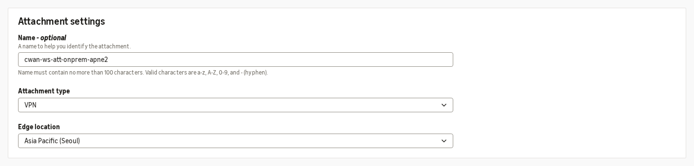
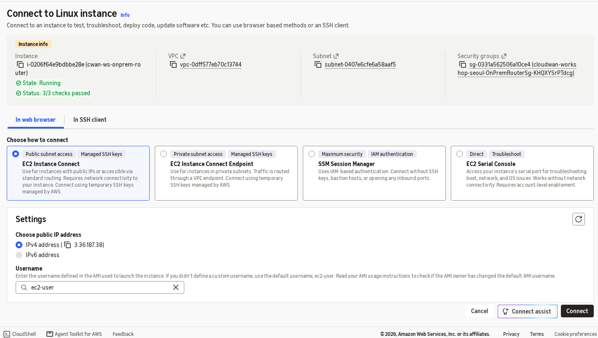
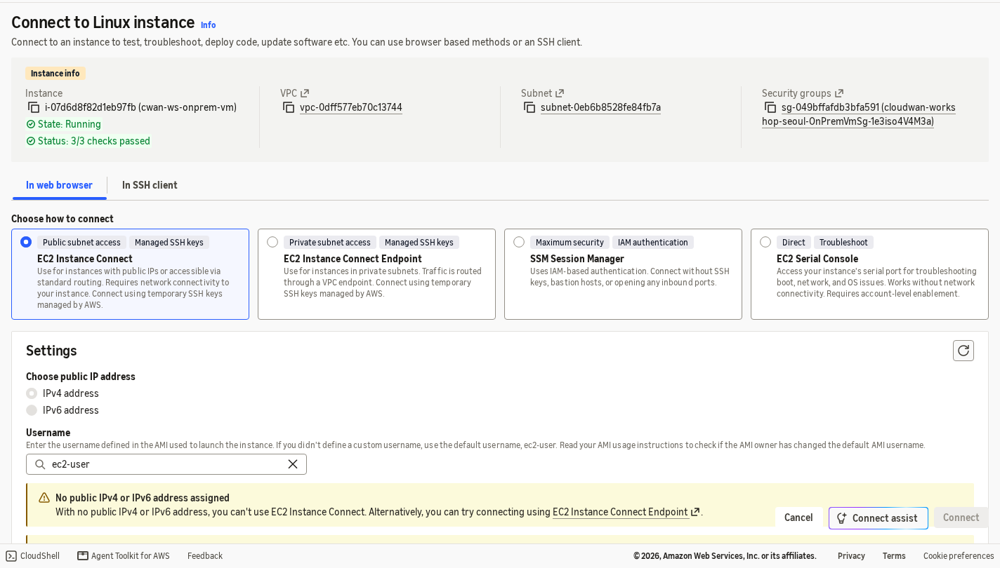

# 2-3. 온프레미스 연결 (20분)

온프레미스 모사 환경을 Site-to-Site VPN으로 Cloud WAN에 연결합니다. VPN 연결은 직접 만들고, 온프레미스 라우터(VPN 라우터 EC2)의 터널 설정은 스크립트가 해 줍니다.

아래 그림 1의 번호 순서로 진행합니다. 처음 보는 용어는 [1-3. 용어 풀이](glossary.md)를 보세요.

<figure markdown="span">
  ![실습 2-3의 온프레미스 연결 과정을 다섯 단계로 보여 주는 구성도. 왼쪽 위에는 다섯 단계를 적은 설명 패널이 있고, 그 아래 온프레미스 박스(172.16.1.0/24)에 온프레미스 VM 172.16.1.10과 strongSwan·FRR이 설치된 VPN 라우터 EC2(Elastic IP)가 들어 있다. 온프레미스에서 오른쪽으로 Customer Gateway(ASN 65000, VPN 라우터의 Elastic IP), 인터넷, Site-to-Site VPN(Not Associated, 게이트웨이 미연결)이 차례로 놓이고, 이 셋은 AWS Cloud 박스 밖에 있다. 오른쪽 AWS Cloud 안에는 보라색 점선의 core network(AWS Cloud WAN) 박스가 있고 그 안에는 core network edge와 세그먼트만 있다. 서울 edge(ASN 64512)가 가운데 줄에, 오레곤 edge(ASN 64513)가 아래에 있으며, 두 edge는 세로 선으로 dev, shared, onprem, prod 네 개의 회색 점선 세그먼트 박스에 모두 연결된다. VPC는 core network 밖의 리전 박스 안에 있다. 서울(ap-northeast-2) 박스에는 dev VPC(10.20.1.0/24), shared VPC(10.30.1.0/24, EC2 10.30.1.10), prod VPC(10.10.1.0/24, EC2 10.10.1.10)가 있고, 오레곤(us-west-2) 박스에는 prod VPC(10.11.1.0/24)와 dev VPC(10.21.1.0/24)가 있다. 각 VPC는 VPC attachment 선 한 줄로 자기 세그먼트 박스에 연결된다. 오레곤 dev VPC만 선이 없고 attachment 없음, 추가 과제 3-1이라고 적혀 있다. 아직 core network에 붙지 않았고 추가 과제 3-1에서 참가자가 dev 세그먼트에 붙인다는 뜻이다. 온프레미스 모사 VPC도 VPC attachment 없이 VPN으로만 연결된다. 1에서 참가자가 Site-to-Site VPN 연결을 Target Gateway Type = Not Associated 상태로 만든다. Customer Gateway는 VPN 라우터의 Elastic IP이고 ASN은 65000이다. 2에서 참가자가 Cloud WAN에서 Site-to-Site VPN attachment를 만들고 segment=onprem 태그를 붙이면, edge location ap-northeast-2의 서울 edge에 붙고 attachment policy의 tag-exists 규칙이 onprem 세그먼트에 배정한다. 서울 edge로 들어가는 선 위에 segment=onprem 태그가 붙어 있다. 3에서 attachment를 붙인 뒤에야 AWS 쪽 터널 엔드포인트(외부 IP 2개)가 생기고, VPN 라우터 EC2에서 setup-tunnels.sh에 VPN 연결 ID를 주어 실행하면 온프레미스 라우터와 AWS 사이에 IPsec 터널 2개와 BGP 세션 2개(AS 65000과 64512)가 올라오면서 온프레미스가 172.16.1.0/24를 광고한다. 터널은 Customer Gateway에서 인터넷을 지나 Site-to-Site VPN으로 가는 평행선 두 줄로 그려져 있다. 4에서 온프레미스 VM 172.16.1.10에서 서울 shared VPC의 EC2 10.30.1.10으로 보내는 통신은 성공한다. 정책에서 shared 세그먼트가 onprem에도 share되어 있기 때문이며, onprem 세그먼트에서 shared 세그먼트로 올라가는 초록 화살표에 성공 레이블이 붙어 있다. 5에서 같은 VM에서 서울 prod VPC의 EC2 10.10.1.10으로 보내는 통신은 실패한다. onprem 세그먼트는 아직 prod와 공유되어 있지 않기 때문이며, onprem에서 prod 세그먼트로 내려가는 빨간 점선 화살표에 차단, 실패 레이블이 붙어 있다. 이 공유는 실습 2-4에서 정책에 share 한 줄을 추가해 연다](images/diagrams/lab2-onprem.png)
  <figcaption>그림 1. 실습 2-3에서 하는 일</figcaption>
</figure>

| 번호 | 단계 | 내용 |
|---|---|---|
| ① | VPN 연결 생성 | Target Gateway Type을 `Not Associated`로 두고 Site-to-Site VPN 연결을 만듭니다. |
| ② | VPN attachment 생성 | VPN 연결을 core network에 붙이고 태그 `segment` = `onprem`을 답니다. |
| ③ | 터널과 BGP 설정 | VPN 라우터에서 스크립트를 실행해 IPsec 터널 2개와 BGP(Border Gateway Protocol)를 설정합니다. |
| ④ | 온프레미스 → shared | ping이 성공합니다. |
| ⑤ | 온프레미스 → prod | ping이 실패합니다. 이것이 맞는 결과입니다. |

시작하기 전에 확인합니다.

- 스택 `cloudwan-workshop-seoul`이 **CREATE_COMPLETE**인가요?
- 스택 **Outputs** 탭에 `CustomerGatewayId`, `CoreNetworkId`, `OnPremEiceId`가 보이나요?
- 콘솔 리전이 **Asia Pacific (Seoul) ap-northeast-2**인가요? (VPN 연결과 라우터는 서울에 있습니다.)

## 2-3-a. VPN 연결 만들기 { #lab2-a }

1. 리전을 **Asia Pacific (Seoul)** 로 바꿉니다.
2. **VPC** 콘솔 → **Site-to-Site VPN connections** → **Create VPN connection**을 누릅니다.
3. 아래 값을 넣습니다. 적지 않은 항목은 기본값으로 둡니다.

    | 항목 | 값 |
    |---|---|
    | Name tag | `cwan-ws-vpn` |
    | Target gateway type | **Not associated** — 목록의 네 번째이자 마지막 항목입니다 |
    | Customer gateway | **Existing**, 스택이 만든 `cwan-ws-onprem-cgw` (ASN `65000`) |
    | Routing options | **Dynamic (requires BGP)** |

4. **Create VPN connection**을 누릅니다.

{ .shot }

!!! info "Target Gateway Type을 `Not Associated`로 두는 이유"
    VPN 연결은 보통 Transit Gateway나 가상 프라이빗 게이트웨이에 연결해 만듭니다. Cloud WAN에 붙일 VPN 연결은 어느 게이트웨이에도 연결하지 않은 상태로 만들고, 다음 단계(2-3-b)에서 core network에 attachment로 붙입니다.

!!! info "정적 라우팅은 쓸 수 없습니다"
    Cloud WAN의 VPN attachment는 BGP만 지원하고 정적 라우팅은 지원하지 않습니다. 그래서 **Routing options**를 **Dynamic (requires BGP)** 로 고릅니다. ([Cloud WAN VPN attachment 만들기](https://docs.aws.amazon.com/vpn/latest/s2svpn/create-cwan-vpn-attachment.html))

**성공 확인**: 목록에서 방금 만든 VPN 연결의 **State**가 **Available**입니다. 이 연결의 ID(`vpn-…`)를 메모해 둡니다. 2-3-c에서 씁니다.

## 2-3-b. Cloud WAN에 VPN 연결 붙이기 { #lab2-b }

1. **Network Manager** 콘솔 → **Global networks** → `cwan-ws-global` → 왼쪽 메뉴 **Core network** 를 엽니다.
2. **Attachments** → **Create attachment**를 누릅니다.
3. 아래 값을 넣습니다. 적지 않은 항목은 기본값 그대로 둡니다.

    | 항목 | 값 |
    |---|---|
    | Name | `cwan-ws-att-onprem-apne2` |
    | Attachment type | **VPN** |
    | Edge location | **Asia Pacific (Seoul)** — 목록에는 리전 코드가 아니라 리전 이름으로 나옵니다 |
    | VPN ID | 2-3-a에서 만든 VPN 연결(`vpn-…`) |

    !!! info "종류 이름은 **VPN** 입니다"
        목록에 **VPN**, **VPC**, **Connect**, **Transit gateway route table**, **Direct Connect Gateway** 다섯 가지가 나옵니다. Site-to-Site VPN 연결을 붙이는 것이 **VPN** 입니다. **VPN ID** 칸은 종류를 **VPN** 으로 바꾼 뒤에 나타납니다.

4. **Tags**에 태그 하나를 넣습니다. [2-2-d](lab1.md#lab1-d)와 같습니다.

    | Key | Value |
    |---|---|
    | `segment` | `onprem` |

5. **Create attachment**를 누릅니다.

{ .shot }

attachment policy는 `segment` 태그 값과 같은 이름의 세그먼트에 attachment를 배정합니다. 그래서 이 태그 하나로 VPN이 `onprem` 세그먼트에 들어갑니다.

**성공 확인**: attachment 목록에서 **Attachment state**가 **Available**이 되고, **Segment**(또는 세그먼트 열)가 `onprem`입니다. 상태가 바뀌기까지 걸리는 시간은 사전 테스트에서 측정합니다.

## 2-3-c. 온프레미스 라우터에 터널 설정하기 { #lab2-c }

!!! info "순서가 a → b → c인 이유"
    AWS 쪽 VPN 터널 엔드포인트는 attachment를 붙인 뒤에 만들어집니다. 그 전에는 customer gateway 장비(여기서는 VPN 라우터)를 설정할 수 없습니다. ([Cloud WAN Site-to-Site VPN attachment](https://docs.aws.amazon.com/network-manager/latest/cloudwan/cloudwan-s2s-vpn-attachment.html)) 그래서 VPN 연결을 만들고(a), attachment를 붙이고(b), 그다음에 라우터를 설정합니다(c).

VPN 라우터 EC2에는 strongSwan(IPsec)과 FRR(BGP) 설정을 만들어 주는 스크립트가 들어 있습니다. VPN 연결 ID만 넣고 실행합니다.

1. **EC2** 콘솔 → **Instances**에서 `cwan-ws-onprem-router`를 골라 **Connect**를 누릅니다.
2. **Connect to Linux instance** 화면의 **In web browser** 탭에서 **Connect**를 누릅니다. [2-2-b](lab1.md#lab1-b)와 같은 화면입니다.

{ .shot }

3. 아래 명령을 **VPN 라우터(`cwan-ws-onprem-router`)** 에서 실행합니다. `<VPN 연결 ID>`는 2-3-a에서 메모한 `vpn-…` 값입니다.

    ```bash
    sudo /opt/onprem/setup-tunnels.sh <VPN 연결 ID>
    ```

스크립트는 `aws ec2 describe-vpn-connections`로 터널 정보(AWS 쪽 주소 2개, 사전 공유 키, BGP 주소)를 받아 IPsec 터널 2개와 BGP 세션 2개를 설정하고, 온프레미스 LAN `172.16.1.0/24`를 광고합니다. 다시 실행해도 됩니다.

사전 테스트에서는 스크립트가 끝나는 시점에 이미 터널과 BGP가 올라와 있었습니다. 마지막 몇 줄이 이렇게 나옵니다.

```text
Neighbor        V         AS   MsgRcvd   MsgSent   TblVer  InQ OutQ  Up/Down State/PfxRcd
169.254.203.157 4      64512         4         2        0    0    0 00:00:01            0
169.254.241.109 4      64512         5         2        0    0    0 00:00:01            1

Total number of neighbors 2

IPv4 unicast VRF default:
B>* 10.30.1.0/24 [20/100] via 169.254.241.109, vti2, weight 1, 00:00:00

Next:
  swanctl --list-sas                  the two IPsec tunnels
  vtysh -c 'show bgp summary'         the two BGP sessions
  vtysh -c 'show ip route bgp'        the routes Cloud WAN sends you
```

스크립트가 다음에 확인할 명령까지 알려 줍니다. 실패하면 `FAILED at:` 줄이 나옵니다.

4. 설정이 끝나면 아래 확인 명령을 **VPN 라우터**에서 실행합니다.

    ```bash
    # IPsec 터널 상태 (aws-tunnel1, aws-tunnel2가 ESTABLISHED이어야 합니다)
    sudo swanctl --list-sas

    # BGP 이웃 상태 (이웃 2개가 Established이어야 합니다)
    sudo vtysh -c 'show bgp summary'

    # Cloud WAN에서 받은 경로 (10.30.1.0/24 한 줄이 보여야 합니다)
    sudo vtysh -c 'show ip route bgp'

    # 우리가 AWS로 내보내는 대역이 BGP에 올라와 있는지
    sudo vtysh -c 'show ip bgp 172.16.1.0/24'
    ```

    !!! info "광고가 AWS에 닿았는지는 반대쪽에서 봅니다"
        터널 내부 주소(`169.254.x.x`)는 VPN 연결을 만들 때마다 AWS가 새로 배정하므로, 이웃 주소를 적어 둔 명령은 계정마다 빗나갑니다. 광고가 실제로 닿았는지는 [2-3-d](#lab2-d)에서 Cloud WAN의 `shared` 세그먼트 경로 테이블에 `172.16.1.0/24` 가 `PROPAGATED` 로 들어왔는지로 확인합니다. 그쪽이 주소를 몰라도 되고, 보고 싶은 것(광고가 전파됐는가)에 더 가깝습니다.

5. 콘솔에서도 확인합니다. **VPC** 콘솔 → **Site-to-Site VPN connections** → 2-3-a에서 만든 연결 → **Tunnel details** 탭을 엽니다. 그 안의 **Tunnel state** 표를 봅니다.

{ .shot }

사전 테스트에서 나온 출력입니다.

```text
$ sudo swanctl --list-sas
aws-tunnel2: #2, ESTABLISHED, IKEv2, b16dcffae62b2e93_i* 8f3a8afcb0412ebf_r
  aws-tunnel2: #2, reqid 1, INSTALLED, TUNNEL-in-UDP, ESP:AES_CBC-256/HMAC_SHA2_256_128
aws-tunnel1: #1, ESTABLISHED, IKEv2, bb499a9dfc03a4fc_i* 2ed50f8d35aed47d_r
  aws-tunnel1: #1, reqid 2, INSTALLED, TUNNEL-in-UDP, ESP:AES_CBC-256/HMAC_SHA2_256_128

$ sudo vtysh -c 'show bgp summary'
BGP router identifier 169.254.203.158, local AS number 65000 VRF default vrf-id 0

Neighbor        V         AS   MsgRcvd   MsgSent   TblVer  InQ OutQ  Up/Down State/PfxRcd   PfxSnt
169.254.203.157 4      64512         6         7        2    0    0 00:00:21            0        2
169.254.241.109 4      64512         7         7        2    0    0 00:00:21            1        2

Total number of neighbors 2

$ sudo vtysh -c 'show ip route bgp'
B>* 10.30.1.0/24 [20/100] via 169.254.241.109, vti2, weight 1, 00:00:20

$ sudo vtysh -c 'show ip bgp 172.16.1.0/24'
BGP routing table entry for 172.16.1.0/24, version 1
  Advertised to peers:
  169.254.203.157 169.254.241.109
```

이웃 주소 `169.254.x.x` 는 **여러분 계정에서는 다른 값**입니다. AWS가 VPN 연결마다 새로 배정합니다.

**성공 확인**

- **Tunnel state** 표의 두 줄이 모두 **Status** `Up`, **Provisioning status** `Available` 이고, **Details** 에 `1 BGP ROUTES` 가 적혀 있습니다. **Inside IPv4 CIDR** 의 `169.254.x.x/30` 두 개가 BGP 이웃 주소가 나온 자리입니다.
- `swanctl --list-sas` 에 `aws-tunnel1` 과 `aws-tunnel2` 가 모두 `ESTABLISHED` 이고 `INSTALLED` 입니다.
- `show bgp summary` 에 **Total number of neighbors 2** 가 보이고, 두 줄 모두 **Up/Down** 이 시간(`00:00:21`)으로 나옵니다. 숫자가 아니라 `Active`/`Connect` 로 나오면 아직 올라오는 중입니다.
- **`show ip route bgp` 에 `10.30.1.0/24`(shared)가 보입니다.**
- `show ip bgp 172.16.1.0/24` 의 **Advertised to peers** 에 이웃 두 개가 모두 적혀 있습니다. 우리 대역을 양쪽 터널로 광고하고 있다는 뜻입니다.

!!! tip "`10.10.1.0/24`(prod)는 보이지 않는 것이 맞습니다"
    `show ip route bgp` 에 shared 대역만 오고 prod 대역은 오지 않습니다. `onprem` 세그먼트가 `shared` 와만 공유되어 있기 때문입니다. **왜 prod로 통신이 안 되는지가 이 한 줄로 설명됩니다.** [2-3-f](#lab2-f)에서 ping으로 다시 확인하고, [2-4](lab3.md)에서 이 경로가 생기는 것을 봅니다.

!!! warning "경로가 아직 안 보이면 기다립니다"
    터널과 BGP 세션이 올라와도 경로가 설치되기까지 잠시 걸릴 수 있습니다. **`show ip route bgp` 에 `10.30.1.0/24` 가 나타난 뒤에 다음 소절로 넘어가세요.** 그 전에 ping을 하면 실패합니다. 사전 테스트에서는 스크립트가 끝났을 때 이미 경로가 들어와 있었지만, 늦어지면 같은 명령을 몇 번 더 돌려 보세요. 고장이 아니라 수렴을 기다리는 것입니다.

스크립트가 실패하면 화면에 `FAILED at:` 줄과 확인할 명령이 나옵니다. 그 내용을 강사에게 보여 주세요.

## 2-3-d. Cloud WAN 쪽 경로 확인하기 { #lab2-d }

앞 소절에서는 **온프레미스 라우터가 받은** 경로를 봤습니다. 이번에는 반대쪽, **Cloud WAN이 받은** 경로를 봅니다. 양쪽이 다 있어야 왕복 통신이 됩니다.

1. **Network Manager** 콘솔 → **Global networks** → `cwan-ws-global` → 왼쪽 메뉴 **Core network** 에서 **Routes** 탭을 엽니다.
2. **Route Filter** 에서 **Segment** 를 `onprem`, **Edge location** 을 `ap-northeast-2` 로 고르고 **Search routes** 를 누릅니다.

    { .shot }

3. 같은 방법으로 **Segment** 를 `shared` 로 바꿔 다시 조회합니다.

    { .shot }

**성공 확인**

- `onprem` 세그먼트에 경로가 **2개뿐**입니다. `10.30.1.0/24`(shared)와 자기 대역 `172.16.1.0/24` 입니다. `10.10.1.0/24`(prod)는 **없습니다**.
- `172.16.1.0/24` 의 **Destinations** 는 `attachment-… | vpn | vpn-…` 입니다. VPN attachment를 통해 들어온 경로라는 뜻이고, 괄호 안은 AWS 쪽 터널 주소입니다.
- `shared` 세그먼트에 `172.16.1.0/24`(온프레미스)가 있습니다. **Route type** 이 `PROPAGATED`, **Route state** 가 `ACTIVE` 이고 **Destinations** 는 VPN attachment입니다. 온프레미스 라우터가 BGP로 광고한 대역이 Cloud WAN까지 전파된 것입니다.

!!! info "이 두 줄이 다음 두 소절의 답입니다"
    `shared` 쪽에 온프레미스 대역이 있으니 [2-3-e](#lab2-e)의 통신이 됩니다. `onprem` 쪽에 prod 대역이 없으니 [2-3-f](#lab2-f)의 통신은 안 됩니다. ping을 하기 전에 결과를 경로로 먼저 알 수 있습니다.

## 2-3-e. 온프레미스에서 공유 서비스로 통신해 보기 { #lab2-e }

온프레미스 VM에서 서울 shared EC2로 ping을 보냅니다.

1. **EC2** 콘솔 → **Instances**에서 `cwan-ws-onprem-vm`을 골라 2-3-c와 같은 방법(EC2 Instance Connect Endpoint)으로 접속합니다.

{ .shot }

2. 아래 명령을 **온프레미스 VM(`172.16.1.10`)** 에서 실행합니다.

    ```bash
    ping -c 5 10.30.1.10
    ```

사전 테스트에서 나온 출력입니다.

```text
PING 10.30.1.10 (10.30.1.10) 56(84) bytes of data.
64 bytes from 10.30.1.10: icmp_seq=1 ttl=124 time=8.92 ms
64 bytes from 10.30.1.10: icmp_seq=2 ttl=124 time=2.69 ms
64 bytes from 10.30.1.10: icmp_seq=3 ttl=124 time=2.64 ms
64 bytes from 10.30.1.10: icmp_seq=4 ttl=124 time=2.73 ms
64 bytes from 10.30.1.10: icmp_seq=5 ttl=124 time=2.72 ms

--- 10.30.1.10 ping statistics ---
5 packets transmitted, 5 received, 0% packet loss, time 4007ms
rtt min/avg/max/mdev = 2.644/3.940/8.917/2.488 ms
```

왕복이 약 2.7밀리초입니다. [2-2-c](lab1.md#lab1-c)의 VPC 사이 통신이 약 1밀리초였으니, IPsec 터널을 거치면서 1.7밀리초쯤 더 걸린 셈입니다. 첫 패킷만 8.9밀리초로 느린 것은 경로를 처음 쓰면서 생기는 지연입니다.

**성공 확인**: `0% packet loss` 이고 5개 모두 응답합니다.

성공하는 이유는 정책에서 `shared` 세그먼트가 `onprem` 세그먼트에도 share하기 때문입니다. 온프레미스는 `shared`의 경로를 받고, `shared`도 온프레미스의 `172.16.1.0/24`를 받습니다.

## 2-3-f. 온프레미스에서 운영으로 통신해 보기 { #lab2-f }

같은 VM에서 서울 prod EC2로 ping을 보냅니다.

1. 아래 명령을 **온프레미스 VM(`172.16.1.10`)** 에서 실행합니다.

    ```bash
    ping -c 5 10.10.1.10
    ```

**결과(실패가 맞습니다)**: `100% packet loss`입니다. 응답이 없는 것이 정상입니다.

```text
PING 10.10.1.10 (10.10.1.10) 56(84) bytes of data.

--- 10.10.1.10 ping statistics ---
5 packets transmitted, 0 received, 100% packet loss, time 4182ms
```

바로 앞 소절과 **같은 터널, 같은 VM**입니다. 달라진 것은 목적지 하나뿐입니다. 터널이 멀쩡한데도 막히는 것이니, 막은 것은 네트워크 연결이 아니라 정책입니다.

`onprem` 세그먼트는 아직 `prod`와 공유되어 있지 않습니다. 세그먼트는 기본적으로 자기 세그먼트 안에서만 통신하므로 `onprem`은 `prod`의 경로를 받지 못합니다. 다음 실습 [2-4](lab3.md)에서 정책에 한 줄을 추가해 이 연결을 엽니다.

## 2-3-g. 정리 { #lab2-g }

| 확인한 것 | 결과 |
|---|---|
| VPN 연결 생성 (Target Gateway Type = `Not Associated`, BGP) | **Available** |
| VPN attachment에 `segment` = `onprem` 태그 | `onprem` 세그먼트에 배정 |
| 터널 2개, BGP 이웃 2개 | **UP**, **Established** |
| 온프레미스 → shared (`10.30.1.10`) | 성공 |
| 온프레미스 → prod (`10.10.1.10`) | 실패 (정책에 공유가 없어서) |

다음은 [2-4. 정책으로 통신 범위 바꾸기](lab3.md)입니다. 이 VPN 연결과 터널은 지우지 말고 그대로 둡니다.
