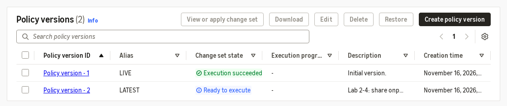
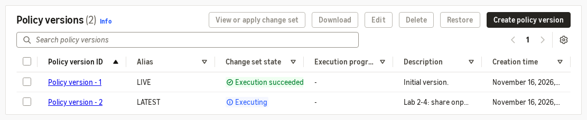
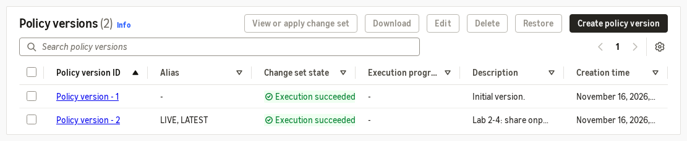

# 2-4. 정책으로 통신 범위 바꾸기 (15분)

이 실습이 워크숍의 결론입니다. 정책(policy)에 JSON 몇 줄을 넣고 반영하면, 서울과 오레곤에 걸친 통신 범위가 한 번에 바뀝니다. 리전마다 따로 설정하지 않습니다. 그 변화를 직접 확인합니다.

<figure markdown="span">
  ![AWS Cloud WAN 실습 2-4의 정책 변경 전후 비교 구성도. 위쪽은 정책 변경 전이다. 왼쪽에 온프레미스 LAN을 나타내는 AWS Site-to-Site VPN이 있고, 그 attachment가 segment=onprem 태그로 core network 안의 onprem 세그먼트에 배정되어 있다. core network 안에는 세그먼트 네 개가 있다. prod 세그먼트는 서울 prod VPC와 오레곤 prod VPC 두 개를 담고, dev 세그먼트도 서울 dev VPC와 오레곤 dev VPC 두 개를 담으며, shared 세그먼트는 서울 shared VPC 하나를, onprem 세그먼트는 Site-to-Site VPN attachment 하나를 담는다. 변경 전 통신 상태는 onprem과 shared는 통신됨, onprem과 prod는 차단, onprem과 dev는 차단, prod와 dev는 차단, shared와 prod는 통신됨, shared와 dev는 통신됨이다. 가운데 밴드는 참가자가 정책의 segment-actions에 추가하는 JSON 조각을 보여 준다. action은 share, mode는 attachment-route, segment는 onprem, share-with는 prod 하나다. 반영 순서는 policy version 생성, change set 검토, 실행이며, 리전별 설정 없이 서울과 오레곤 prod 양쪽이 함께 열리고 dev 격리는 그대로 둔다고 적혀 있다. 아래쪽은 정책 변경 후이며 위쪽과 배치가 완전히 같다. 달라진 것은 onprem과 prod 사이 선 하나뿐으로, 빨간 점선 차단이 굵은 초록 실선 통신됨으로 바뀌고 정책에서 바뀐 부분이라는 표시가 붙는다. 이 한 선으로 온프레미스는 서울 prod VPC와 오레곤 prod VPC 양쪽에 모두 닿는다. 나머지는 그대로다. 온프레미스는 서울 dev VPC와 오레곤 dev VPC 어느 쪽에도 닿지 않고, prod와 dev도 여전히 차단이며, onprem과 shared는 그대로 통신됨, shared와 prod, dev도 그대로 통신됨이다](images/diagrams/lab3-policy.png)
  <figcaption>그림 2-4-1. 정책 한 줄로 바뀌는 것</figcaption>
</figure>

[2-3](lab2.md)에서 온프레미스 VM `172.16.1.10`은 서울 shared EC2에는 닿았지만 서울 prod EC2에는 닿지 못했습니다. `onprem` 세그먼트가 `prod`와 아무것도 공유하지 않았기 때문입니다. 이번에는 정책에 `onprem`과 `prod`의 share를 넣어 이 둘을 연결합니다.

## 2-4-a. 정책에 share 한 줄 넣기 { #lab3-a }

현재 정책을 바탕으로 새 policy version을 만듭니다. `segment-actions`에 share 하나를 더 넣습니다.

1. **Network Manager** 콘솔 → **Global networks** → `cwan-ws-global` → 왼쪽 메뉴 **Core network** 를 엽니다.
2. 왼쪽 메뉴에서 **Policy versions** 를 엽니다.

    !!! warning "왼쪽 메뉴의 **Policies**가 아닙니다"
        왼쪽 메뉴에도 **Policies**라는 항목이 있지만 그것은 VPC IP Address Manager 쪽이라 전혀 다른 화면입니다. core network 안의 **Policy versions**로 가세요.

3. **Alias** 가 **LIVE** 인 버전 행의 **선택 버튼**을 누르고, 표 위쪽의 **Edit** 를 누릅니다. **Create policy** 화면이 열립니다.
4. **Choose policy view mode** 에서 **JSON** 을 고릅니다.

    !!! warning "기본값은 **Visual editor** 입니다"
        그대로 두면 폼으로 한 칸씩 채우는 화면이 나옵니다. 아래 JSON 조각을 붙여 넣으려면 **JSON** 으로 바꿔야 합니다. 바꾸면 현재 정책 전체가 줄 번호가 달린 편집기에 그대로 들어 있습니다.

5. **Details** 의 **Description** 에 나중에 알아볼 수 있는 설명을 적습니다. 예: `Lab 2-4: share onprem with prod`. 정책 버전 목록에서 이 설명으로 버전을 구분합니다.
6. **JSON** 편집기에서 `segment-actions` 배열에 다음 항목을 추가합니다.

    ```json
    {
      "action": "share",
      "mode": "attachment-route",
      "segment": "onprem",
      "share-with": ["prod"]
    }
    ```

    넣을 위치는 기존 `shared` share 항목의 바로 뒤입니다. 두 항목 사이에 쉼표(`,`)가 있어야 합니다. 편집을 마친 `segment-actions`는 다음과 같습니다.

    ```json
      "segment-actions": [
        {
          "action": "share",
          "mode": "attachment-route",
          "segment": "shared",
          "share-with": ["prod", "dev", "onprem"]
        },
        {
          "action": "share",
          "mode": "attachment-route",
          "segment": "onprem",
          "share-with": ["prod"]
        }
      ],
    ```

    `share-with`에 `dev`는 넣지 않습니다. 고객 요구사항은 온프레미스가 개발 환경에 닿지 않는 것입니다.

    !!! info "한 줄이면 됩니다. `share` 는 양방향입니다"
        `onprem` 쪽에만 적었는데 `prod` → `onprem` 방향은 따로 적지 않아도 되는지 궁금할 수 있습니다. **적지 않습니다.** `share` 는 두 세그먼트가 서로에게 경로를 광고하게 만듭니다(공식 문서의 표현은 "create mutual advertisements"입니다). 반대 방향을 위한 항목은 없습니다.

        [2-4-d](#lab3-d)에서 양쪽 경로 테이블을 보면 확인됩니다. `prod` 에 온프레미스 대역 `172.16.1.0/24` 가 들어오고, `onprem` 에 운영 대역 `10.10.1.0/24` 가 들어옵니다. **한 줄이 양쪽을 다 만든 것입니다.**

        콘솔의 **Visual editor** → **Segment actions** 탭에서는 이 공유가 `onprem` 한 줄로만 보입니다(**Shared with segments** 열에 `prod`). 한쪽 방향처럼 보이지만 그 한 줄이 양방향입니다. 더 자세한 것은 [4-1-d. segment-actions](concepts.md#actions)에 있습니다.

7. **Create policy** 를 누릅니다. 새 버전이 만들어지고, Cloud WAN이 현재 **LIVE** 버전과 비교해 change set을 만들기 시작합니다.

<figure markdown="span">
  { .shot }
  <figcaption>그림 2-4-2. 정책 편집기의 JSON 보기</figcaption>
</figure>

**결과**: 정책 버전 목록에 새 버전이 보입니다.

<figure markdown="span">
  { .shot }
  <figcaption>그림 2-4-3. 새 버전 생성 직후의 Policy versions 목록</figcaption>
</figure>

## 2-4-b. change set 검토하기 { #lab3-b }

새 버전을 만들면 Cloud WAN이 현재 적용 중인 정책과 새 버전을 비교해 change set(바뀌는 내용의 목록)을 만듭니다. 적용하기 전에 무엇이 바뀌는지 읽어 봅니다.

1. **Policy versions** 목록에서 방금 만든 버전(**Alias** 가 **LATEST**) 행의 **선택 버튼**을 누르고, 표 위쪽의 **View or apply change set** 을 누릅니다. **Policy version - 2 change sets** 처럼 버전 번호가 붙은 화면이 열립니다.
2. 바뀌는 항목을 읽습니다. 이번 변경에서는 `onprem`과 `prod` 사이의 share가 새로 생기는 것이 보여야 합니다.
3. 의도하지 않은 항목(세그먼트 삭제 등)이 없는지 확인합니다.

!!! info "이 단계에서는 아직 반영되지 않습니다"
    정책 버전은 만들기만 해서는 배포되지 않습니다. 다음 단계에서 change set을 실행해야 적용됩니다. 그전까지 통신 범위는 그대로입니다. 버전을 만들고 **Ready to execute** 가 된 상태에서 온프레미스 VM에서 prod로 ping을 하면 그대로 `100% packet loss` 입니다.

    change set이 **Ready to execute** 가 되기까지 **1분 안쪽**입니다. 그동안 상태는 `Pending generation` 입니다.

!!! tip "세그먼트를 추가·삭제하거나 격리 옵션을 바꿀 때"
    세그먼트를 추가·삭제하거나 격리 옵션을 바꾸면 그 세그먼트의 모든 edge에 작업이 생깁니다. 이번 변경은 share 추가입니다.

<figure markdown="span">
  { .shot }
  <figcaption>그림 2-4-4. change set의 변경 목록</figcaption>
</figure>

`share` 한 줄을 넣었을 뿐인데 변경은 **7건** 나옵니다. 무엇이 바뀌는지 읽어 보면 이렇습니다.

| **Type** | 개수 | **Action** | 내용 |
|---|---|---|---|
| **Core network segment** | 4 | **Modify** | 세그먼트 네 개의 정의가 바뀝니다. 공유 관계는 세그먼트 설정의 일부라서 `onprem` 과 `prod` 만이 아니라 네 개가 모두 비교 대상에 들어옵니다 |
| **Attachment route propagation** | 3 | **Add** | 경로가 새로 전파되는 연결입니다. VPN attachment 하나(온프레미스 대역이 `prod` 로 들어감), 그리고 서울 prod와 오레곤 prod attachment 둘(두 대역이 `onprem` 으로 들어감) |

**정책 한 줄이 리전 양쪽에 동시에 적용됩니다.** 오레곤 prod attachment는 여러분이 따로 건드리지 않았는데 전파 대상에 들어 있습니다.

!!! info "**Identifier** 열은 비어 있습니다"
    목록에서는 어느 연결인지 보이지 않고 `-` 로 나옵니다. 구체적인 대상은 **New values** 의 **Details** 를 눌러야 보입니다. 목록에서 읽을 것은 **Type** 과 **Action**, 그리고 개수입니다.

**결과**: 변경 목록에 **Attachment route propagation** / **Add** 가 있고, 세그먼트를 지우거나(**Delete**) 만드는(**Create**) 항목은 없습니다.

## 2-4-c. change set 실행하기 { #lab3-c }

change set을 실행해 새 버전을 적용합니다.

1. change set 화면 오른쪽 위의 **Apply change set** 을 누릅니다.
2. **Policy versions** 목록에서 **Change set state** 가 **Ready to execute** → **Executing** → **Execution succeeded** 로 바뀌는 것을 지켜봅니다. **1분쯤** 걸립니다.
3. 새 정책이 **LIVE**가 되었는지 확인합니다.

**Executing** 에 머무르는 동안에는 다음 소절로 가지 말고 기다립니다. 반영이 끝나기 전에 ping을 하면 그대로 실패합니다.

<figure markdown="span">
  { .shot }
  <figcaption>그림 2-4-5. change set 실행 중의 Policy versions 목록</figcaption>
</figure>

<figure markdown="span">
  { .shot }
  <figcaption>그림 2-4-6. 실행이 끝난 Policy versions 목록</figcaption>
</figure>

**결과**: change set 상태가 **Execution succeeded**이고, 새 정책 버전이 **LIVE**로 표시됩니다.

## 2-4-d. 다시 통신해 보기 { #lab3-d }

[2-3](lab2.md)에서 실패했던 통신을 다시 시도합니다. 세 ping 모두 **온프레미스 VM(`172.16.1.10`)** 에서 실행합니다. 터미널이 닫혔으면 [2-3-e](lab2.md#lab2-e)와 같은 방법으로 `cwan-ws-onprem-vm`에 다시 **Connect** 합니다.

1. 서울 prod EC2로 ping을 보냅니다.

    ```bash
    ping -c 5 10.10.1.10
    ```

2. 오레곤 prod EC2로 ping을 보냅니다.

    ```bash
    ping -c 5 10.11.1.10
    ```

출력은 이렇습니다.

```text
$ ping -c 5 10.10.1.10            # 서울 prod
5 packets transmitted, 5 received, 0% packet loss, time 4005ms
rtt min/avg/max/mdev = 3.043/4.455/7.496/1.780 ms

$ ping -c 5 10.11.1.10            # 오레곤 prod
5 packets transmitted, 5 received, 0% packet loss, time 4006ms
rtt min/avg/max/mdev = 123.230/123.789/125.858/1.035 ms
```

**결과**: 두 ping 모두 응답이 오고 **0% packet loss**입니다. 조금 전 [2-3-f](lab2.md#lab2-f)에서 `100% packet loss` 였던 그 명령입니다. 바뀐 것은 정책 한 줄뿐입니다.

오레곤은 따로 설정하지 않았는데도 함께 열렸습니다. 정책이 `prod` 세그먼트 전체에 적용되기 때문이고, [2-4-b](#lab3-b)의 change set에 오레곤 prod attachment가 들어 있던 것이 그 예고였습니다. 왕복 123밀리초는 온프레미스에서 서울을 거쳐 오레곤까지 간 거리입니다.

이번에는 같은 터미널에서 dev EC2로 ping을 보냅니다. 고객 요구사항대로 실패해야 합니다.

```bash
ping -c 3 10.20.1.10
```

**결과(실패가 맞습니다)**: **100% packet loss**입니다. `onprem`과 `dev` 사이에는 share가 없습니다.

```text
PING 10.20.1.10 (10.20.1.10) 56(84) bytes of data.

--- 10.20.1.10 ping statistics ---
3 packets transmitted, 0 received, 100% packet loss, time 2108ms
```

**같은 터널로 prod는 되고 dev는 안 됩니다.** 고객 요구사항이 정확히 그것이었고, 정책의 `share-with` 에 `prod` 만 적고 `dev` 를 적지 않은 결과입니다.

prod ↔ dev도 여전히 막혀 있습니다. 시간이 있으면 서울 prod EC2에서 dev EC2 `10.20.1.10`으로 ping을 보내 확인해 보세요([2-2-b](lab1.md#lab1-b)와 같은 방법입니다). 이쪽도 응답이 없는 것이 맞습니다.

## 2-4-e. 워크숍 정리 { #lab3-e }

| 확인한 것 | 결과 |
|---|---|
| 기본 동작 | 세그먼트는 같은 세그먼트끼리만 통신. `prod` ↔ `dev`는 따로 막을 필요가 없음 |
| 공유 서비스 | `shared`가 `prod`·`dev`·`onprem`에 share. 세 세그먼트는 `shared`에 닿지만 서로는 닿지 않음 |
| 글로벌 연결 | 서울과 오레곤의 `prod`가 같은 세그먼트로 통신 |
| 정책 변경 전 | 온프레미스 → `prod` 차단 |
| 정책 변경 후 | 온프레미스 → 서울 `prod`, 오레곤 `prod` 통신. `dev`는 계속 차단 |
| 반영 방법 | share 항목 하나 추가 → change set 검토 → 실행 |

Transit Gateway로 같은 일을 하려면 리전마다 라우팅 테이블을 따로 만들고, 연결(attachment)마다 연결과 전파(propagation)를 따로 설정해야 합니다. 리전이 늘수록 설정할 곳도 늘어납니다. Cloud WAN에서는 이 일을 정책 한 곳의 몇 줄로 했고, 모든 리전에 같이 적용되었습니다.

이제 [3-4 리소스 정리](extra-d.md)를 **반드시** 하세요. 정리하지 않으면 요금이 계속 나옵니다. 시간이 남으면 [3-1](extra-a.md) ~ [3-3](extra-c.md)을 해 보세요.
